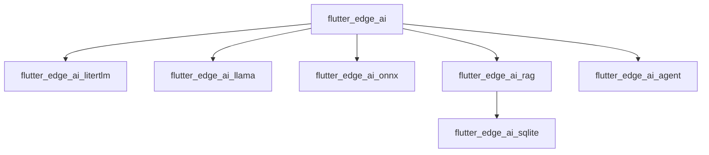

# DenisovAV/flutter_gemma

> Ensemble de paquets Flutter pour exécuter des modèles d'IA sur l'appareil, sans serveur ni cloud.

## Le problème
Embarquer un LLM, des embeddings ou de la voix dans une application Flutter oblige à intégrer soi-même plusieurs moteurs d'inférence.

## Ce que ça fait vraiment
Un noyau `flutter_edge_ai` installe les modèles et les confie à des moteurs optionnels : LiteRT-LM, MediaPipe, llama.cpp (GGUF), ONNX Runtime, modèle intégré à l'OS. Paquets séparés pour embeddings, RAG (SQLite, Qdrant), voix, skills d'agent et Genkit.

## Comment c'est branché

## Essayer
Aucune commande dans ce README : renvoi vers le README du noyau et le guide de démarrage. Exemple d'application dans `packages/flutter_edge_ai/example`.

## Coût et pièges
Gratuit, mais les modèles se téléchargent et pèsent lourd sur mobile. Le support varie selon la plateforme et le moteur. Les anciens noms `flutter_gemma*` restent publiés tels quels jusqu'au noyau 1.11.4.

## Ce que ce n'est pas
Pas un modèle ni un service : des paquets d'intégration. Pas une solution hors Flutter.

## Alternatives
Aucune citée dans le README.

## Pour toi
Surveiller : utile si tu portes de l'IA embarquée sur mobile avec Flutter, sinon hors de ton périmètre.

