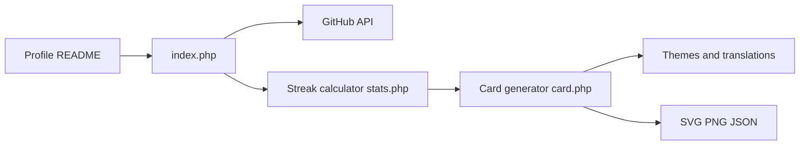

# DenverCoder1/github-readme-streak-stats

> Generates an SVG card of GitHub contribution streaks to display in your profile README.

## The problem
GitHub does not show the streak of consecutive contribution days on the profile.

## What it actually does
A PHP service that reads the contribution graph through the GitHub API, computes the current streak, longest streak and total, then renders an SVG, PNG or JSON card, themable and localizable. Three uses: a public endpoint, GitHub Actions generating a static SVG, or self-hosting (Vercel, Heroku, Docker).

## How it is wired


## Trying it
```bash
docker build -t streak-stats .
docker run -d -p 8080:80 -e TOKEN=your_github_token_here streak-stats
```
Or in markdown: `[](https://git.io/streak-stats)`.

## Cost and gotchas
Free on Vercel; Heroku is paid ($5 to $7/month according to the README). A GitHub token is required when self-hosting. The public endpoint may be unavailable.

## What it is not
Not a team activity analysis tool. PNG requires Inkscape (absent on Vercel).

## Alternatives
No alternative named in the README; the GitHub Actions option avoids depending on the public service.

## For you
Ignore: a GitHub profile gadget, of no value for your data/AI work.
