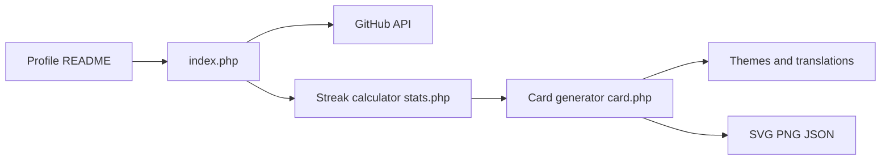

# DenverCoder1/github-readme-streak-stats

> Génère une carte SVG de séries de contributions GitHub à afficher dans son README de profil.

## Le problème
GitHub n'affiche pas la série de jours de contribution consécutifs sur le profil.

## Ce que ça fait vraiment
Service PHP qui lit le graphe de contributions via l'API GitHub, calcule série en cours, plus longue série et total, puis rend une carte SVG, PNG ou JSON, thémable et localisable. Trois usages : endpoint public, GitHub Actions générant un SVG statique, ou auto-hébergement (Vercel, Heroku, Docker).

## Comment c'est branché


## Essayer
```bash
docker build -t streak-stats .
docker run -d -p 8080:80 -e TOKEN=your_github_token_here streak-stats
```
Ou en markdown : `[](https://git.io/streak-stats)`.

## Coût et pièges
Gratuit sur Vercel ; Heroku payant (5 à 7 $/mois selon le README). Jeton GitHub nécessaire en auto-hébergement. L'endpoint public peut être indisponible.

## Ce que ce n'est pas
Pas un outil d'analyse d'activité d'équipe. PNG exige Inkscape (absent sur Vercel).

## Alternatives
Aucune alternative nommée dans le README ; l'option GitHub Actions évite de dépendre du service public.

## Pour toi
À ignorer : gadget de profil GitHub, sans valeur pour ton travail data/IA.

