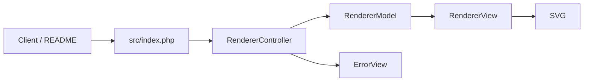

# DenverCoder1/readme-typing-svg

> Generates an SVG image of "typed" text to paste into a GitHub profile README.

## The problem
A GitHub README does not allow animation; you want a dynamic header without JavaScript.

## What it actually does
A PHP service returns an SVG from URL parameters: `lines`, font, color, size, duration, pause, loop, groups. A demo page lets you preview. A stateless application with no database, structured as controller, model, view; fonts come from Google Fonts.

## How it is wired


## Trying it
```md
[](https://git.io/typing-svg)
```

## Cost and gotchas
Free. The public instance is hosted by the author; the README advises self-hosting (PHP or Heroku) for availability.

## What it is not
Not a library to integrate: a cosmetic HTTP service.

## Alternatives
No alternative named in the README.

## For you
Ignore: purely decorative, no value for data/AI/MLOps.
