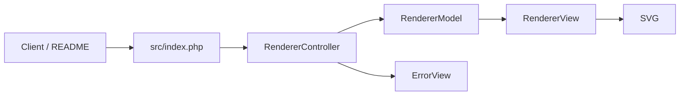

# DenverCoder1/readme-typing-svg

> Génère une image SVG de texte « tapé » à coller dans un README de profil GitHub.

## Le problème
Un README GitHub ne permet pas d'animation ; on veut un en-tête dynamique sans JavaScript.

## Ce que ça fait vraiment
Un service PHP renvoie un SVG à partir des paramètres d'URL : `lines`, police, couleur, taille, durée, pause, boucle, groupes. Une page de démo permet l'aperçu. Application sans état ni base de données, structurée en contrôleur, modèle, vue ; les polices viennent de Google Fonts.

## Comment c'est branché


## Essayer
```md
[](https://git.io/typing-svg)
```

## Coût et pièges
Gratuit. L'instance publique est hébergée par l'auteur ; le README conseille d'auto-héberger (PHP ou Heroku) pour la disponibilité.

## Ce que ce n'est pas
Pas une bibliothèque à intégrer : un service HTTP cosmétique.

## Alternatives
Aucune alternative nommée dans le README.

## Pour toi
Ignorer : purement décoratif, sans valeur pour data/IA/MLOps.

