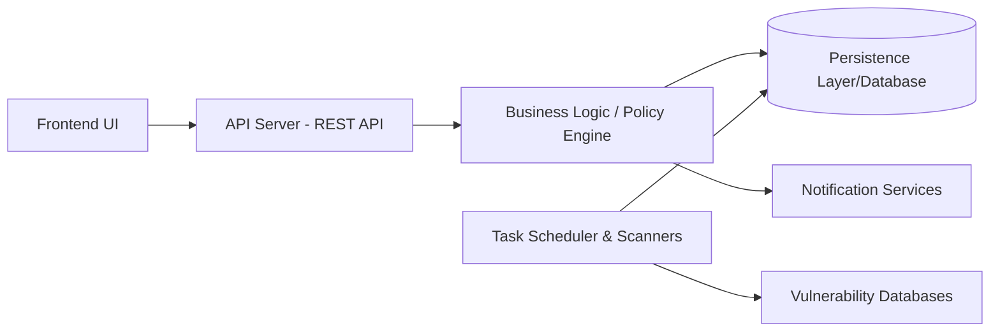

# DependencyTrack/dependency-track

> OWASP component analysis platform that relies on SBOMs to measure software supply chain risk.

## The problem
A project's dependencies carry known vulnerabilities, but nobody knows which ones are present or in which projects.

## What it actually does
- Ingests SBOMs and cross-references components with vulnerability databases (NVD, GitHub Advisories, OSV, Snyk, Trivy, OSS Index, VulnDB).
- Evaluates policies, computes metrics (EPSS included) and traces audits.
- Notifies via Slack, email, Teams or webhooks.
- OAuth 2.0/OIDC, LDAP/Active Directory authentication, API keys.

## How it is wired


## Trying it
The README points to a Quickstart tutorial (Docker Compose) without giving the command.

```bash
# non documenté dans le README — suivre le Quickstart de la documentation
```

## Cost and gotchas
Free (Apache-2.0), self-hosted. v5 is the current version; v4 (branch `4.14.x`) is in maintenance and will end in December 2026: plan the migration (V5_MIGRATION.md). 876 open issues.

## What it is not
Not an SBOM generator: you must supply them from your pipeline. It fixes nothing, it only reports. The frontend, documentation and Helm charts live in separate repositories.

## Alternatives
No alternative named in the README.

## For you
Adopt: if you ship models or services with Python/Java dependencies, this is a concrete way to track vulnerabilities through SBOMs, a project backed by OWASP and active.
