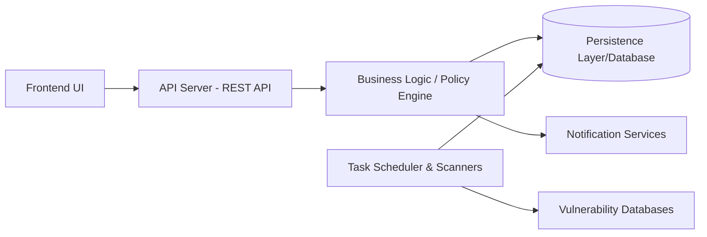

# DependencyTrack/dependency-track

> Plateforme OWASP d'analyse de composants qui s'appuie sur les SBOM pour mesurer le risque de la chaîne logicielle.

## Le problème
Les dépendances d'un projet embarquent des vulnérabilités connues, mais personne ne sait lesquelles sont présentes ni dans quels projets.

## Ce que ça fait vraiment
- Ingère des SBOM et croise les composants avec des bases de vulnérabilités (NVD, GitHub Advisories, OSV, Snyk, Trivy, OSS Index, VulnDB).
- Évalue des politiques, calcule des métriques (EPSS compris) et trace l'audit.
- Notifie via Slack, e-mail, Teams ou webhooks.
- Authentification OAuth 2.0/OIDC, LDAP/Active Directory, clés d'API.

## Comment c'est branché


## Essayer
Le README renvoie à un tutoriel Quickstart (Docker Compose) sans en donner la commande.

```bash
# non documenté dans le README — suivre le Quickstart de la documentation
```

## Coût et pièges
Gratuit (Apache-2.0), à héberger. La v5 est la version courante ; la v4 (branche `4.14.x`) est en maintenance et prendra fin en décembre 2026 : prévoir la migration (V5_MIGRATION.md). 876 issues ouvertes.

## Ce que ce n'est pas
Ce n'est pas un générateur de SBOM : il faut en fournir depuis son pipeline. Il ne corrige rien, il signale. Le frontend, la documentation et les charts Helm vivent dans des dépôts séparés.

## Alternatives
Aucune alternative nommée dans le README.

## Pour toi
Adopter : si tu livres des modèles ou services avec des dépendances Python/Java, c'est un moyen concret de suivre les vulnérabilités par SBOM, projet porté par l'OWASP et actif.

