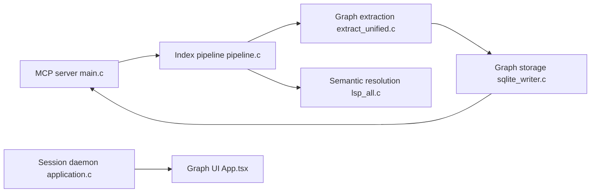

# DeusData/codebase-memory-mcp

> A C-based MCP server that indexes code, documentation, and infrastructure within a local graph for agents.

## The problem
The agents examine the code file by file, without linking the documentation, configuration, or deployment to the code.

## What it actually does
Native binary exposing 17 MCP tools: search (structural, BM25, semantic), call tracing, impact of changes, Cypher queries, ADR. Also indexes Docker, Kubernetes, Helm, Terraform, and Ansible. 162 tree-sitter grammars, "Hybrid LSP" type resolution for 12 languages. A shared daemon manages watchers and the optional CBM Lens UI (beta v0.0.1). The README states that there are 10 times fewer tokens across 31 repositories.

## How it is wired


## Trying it
```bash
curl -fsSL https://raw.githubusercontent.com/DeusData/codebase-memory-mcp/main/install.sh | bash
codebase-memory-mcp daemon start --open --port=9749
codebase-memory-mcp cli list_projects
```

## Cost and gotchas
Free, local, and keyless. Windows Defender may report a false positive on the binary (as documented). All active processes must use the same build. The native test in the README shows 1 failure on macOS.

## What it is not
This is not a code generator. The CBM Lens chatbot uses a small web browser model (WebGPU) that does not modify anything. The lack of an edge may be due to an indexing limitation.

## Alternatives
No alternative is specified in the README file.

## For you
Things to watch out for: very rich (extensive codebase), but with a large surface area and only one maintainer. Compare it to a simpler indexing system before implementing it.
