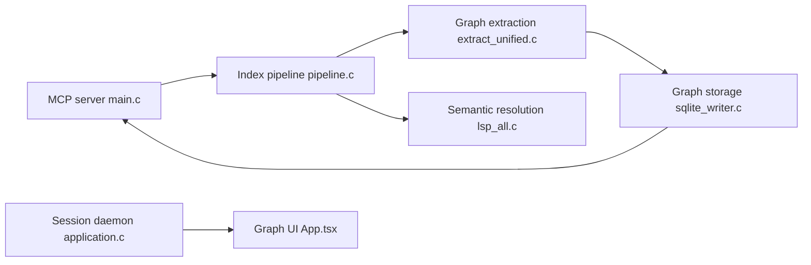

# DeusData/codebase-memory-mcp

> Serveur MCP en C qui indexe code, docs et infrastructure dans un graphe local pour les agents.

## Le problème
Les agents explorent le code fichier par fichier et ne relient ni la doc, ni la configuration, ni le déploiement au code.

## Ce que ça fait vraiment
Binaire natif exposant 17 outils MCP : recherche (structurelle, BM25, sémantique), traçage d'appels, impact des changements, requêtes Cypher, ADR. Indexe aussi Docker, Kubernetes, Helm, Terraform, Ansible. 162 grammaires tree-sitter, résolution de types « Hybrid LSP » pour 12 langages. Un daemon partagé gère watcher et UI optionnelle CBM Lens (bêta v0.0.1). Le README annonce 10× moins de tokens sur 31 dépôts.

## Comment c'est branché


## Essayer
```bash
curl -fsSL https://raw.githubusercontent.com/DeusData/codebase-memory-mcp/main/install.sh | bash
codebase-memory-mcp daemon start --open --port=9749
codebase-memory-mcp cli list_projects
```

## Coût et pièges
Gratuit, local, sans clé. Windows Defender peut signaler un faux positif sur le binaire (documenté). Tous les processus actifs doivent partager le même build. Le test natif du README affiche 1 échec sur macOS.

## Ce que ce n'est pas
Pas un générateur de code. Le chat de CBM Lens utilise un petit modèle navigateur (WebGPU) qui n'édite rien. L'absence d'arête peut venir d'une limite d'indexation.

## Alternatives
Aucune alternative nommée dans le README.

## Pour toi
À surveiller : très riche (infra + code), mais surface énorme et un seul mainteneur ; compare-le à un indexeur plus simple avant de l'imposer.

