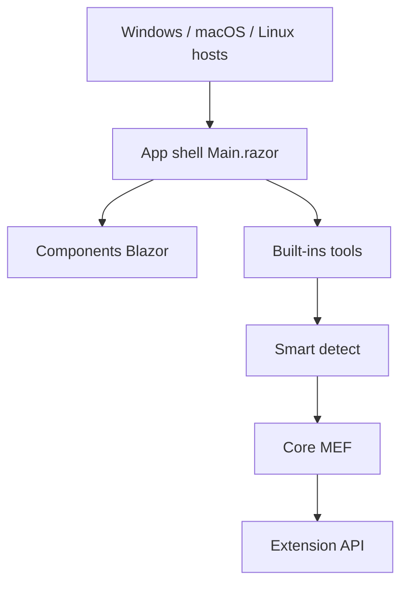

# DevToys-app/DevToys

> Desktop toolbox for developers: conversions, encodings, formatting and quick generators.

## The problem
Decoding a JWT, formatting JSON or compressing an image often means going through untrustworthy websites.

## What it actually does
About thirty local tools: converters (JSON/YAML, dates, bases), encoders/decoders (Base64, GZip, JWT, QR), formatters (JSON, SQL, XML), generators (hash, passwords, Lorem Ipsum), testers (RegEx, JSONPath, XML), image compression. "Smart detection" picks the tool based on the clipboard. Extensions add tools. A command-line mode also exists.

## How it is wired

## Trying it
No command in the README: install via the Microsoft Store or the repository's Releases.

## Cost and gotchas
Free. .NET application with a Blazor interface in a native webview; Linux and macOS are less polished than Windows (the README does not detail their installation).

## What it is not
Not a library nor a collaborative tool. Does not replace `jq` or scripts when you need to automate.

## Alternatives
No alternative mentioned in the README.

## For you
Adopt as a local Swiss army knife: useful for debugging a JWT, a regex or an API JSON without sending your data to a third-party site.
