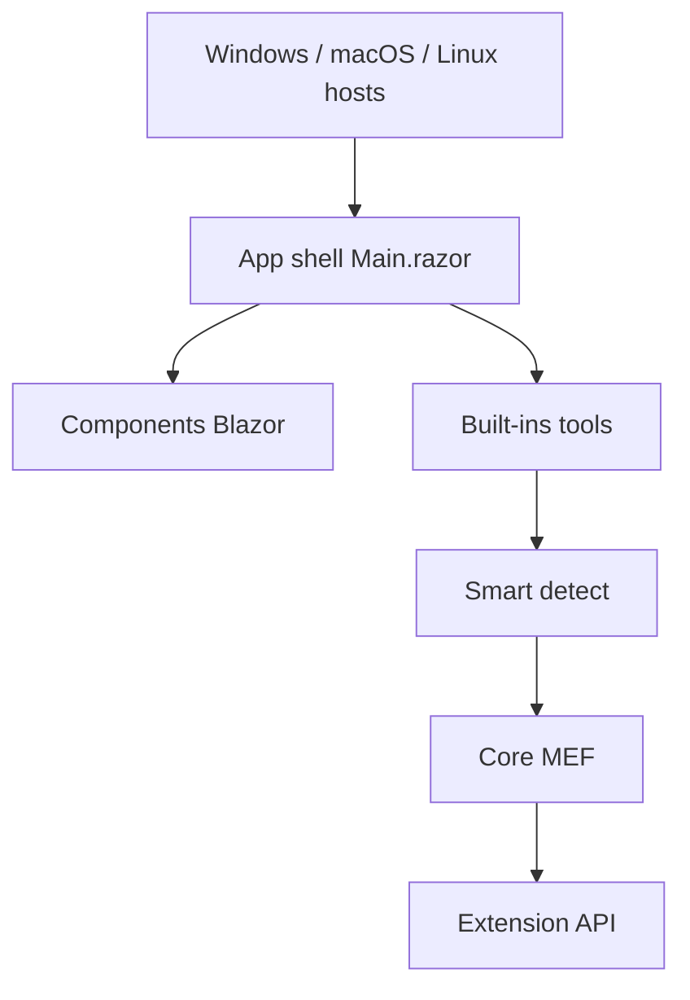

# DevToys-app/DevToys

> Boîte à outils de bureau pour développeurs : conversions, encodages, formatage et générateurs rapides.

## Le problème
Décoder un JWT, formater du JSON ou comprimer une image oblige souvent à passer par des sites web peu fiables.

## Ce que ça fait vraiment
Une trentaine d'outils locaux : conversions (JSON/YAML, dates, bases), encodeurs/décodeurs (Base64, GZip, JWT, QR), formateurs (JSON, SQL, XML), générateurs (hash, mots de passe, Lorem Ipsum), testeurs (RegEx, JSONPath, XML), compression d'images. La « détection intelligente » choisit l'outil d'après le presse-papiers. Des extensions ajoutent des outils. Il existe aussi un mode ligne de commande.

## Comment c'est branché

## Essayer
Aucune commande dans le README : installation via le Microsoft Store ou les Releases du dépôt.

## Coût et pièges
Gratuit. Application .NET avec interface Blazor dans une webview native ; Linux et macOS sont moins soignés que Windows (le README ne détaille pas leur installation).

## Ce que ce n'est pas
Pas une bibliothèque ni un outil collaboratif. Ne remplace pas `jq` ou des scripts quand il faut automatiser.

## Alternatives
Aucune alternative citée dans le README.

## Pour toi
À adopter comme couteau suisse local : utile pour déboguer un JWT, une regex ou un JSON d'API sans envoyer tes données à un site tiers.

