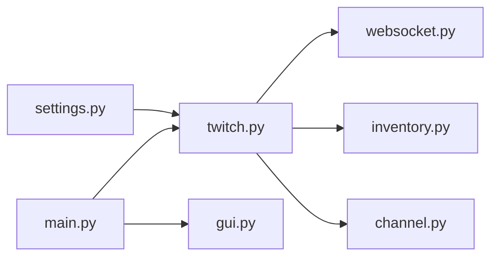

# DevilXD/TwitchDropsMiner

> Desktop application that advances Twitch "drops" without downloading the video stream.

## The problem
Earning Twitch rewards requires keeping streams open and switching channels by hand.

## What it actually does
Logs into your account, lists the campaigns, picks an eligible channel, simulates watching through stream metadata and claims the rewards. A websocket tracks channels going online or offline. Game priorities and exclusions, automatic switching between channels.

## How it is wired

## Trying it
Download and unzip the latest release, launch the application, log in, add games to the priority list then "Reload". No command documented.

## Cost and gotchas
Free. The `cookies.jar` file gives access to the Twitch account: protect it. Watching a stream on the same account skews the progress.

## What it is not
Neither Docker, nor headless execution, nor multi-account, nor 24/7 server: all refused by the author. The Windows executable may be flagged by antivirus software.

## Alternatives
None cited in the README.

## For you
Gamer utility, unrelated to data/AI, and relying on a third-party service: ignore.
