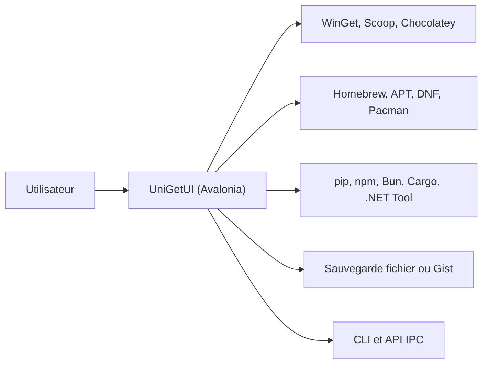

# Devolutions/UniGetUI

> Single graphical interface for command-line package managers, Windows first.

## The problem
Installing and updating software goes through WinGet, Scoop, Chocolatey, pip, npm, etc.: so many different commands and interfaces.

## What it is not
Not a package manager: it drives WinGet, Scoop, Chocolatey, pip, npm and others from a single interface, without replacing them.

## What it actually does
Discover, install, update and uninstall packages from several managers in a single window, in bulk if needed. It handles automatic or per-package ignored updates, scheduled maintenance, export/import of package lists, local backup or in a secret GitHub Gist, an operation history, a CLI and a local IPC API. Portable mode available. Builds are compiled with NativeAOT.

## How it is wired


## Trying it
```bash
winget install --exact --id Devolutions.UniGetUI --source winget
scoop bucket add extras
scoop install extras/unigetui
choco install unigetui
```

## Cost and gotchas
Free, MIT. Packages come from third parties and may be compromised; the README also warns about fake sites (wingetui•com, unigetui•com). Antivirus software may flag the executable. Linux: glibc 2.27 or newer.

## What it is not
Not a package manager: it drives the existing managers and provides no security verification of its own. The official site is devolutions.net/unigetui, no other.

## Alternatives
WinGet, Scoop, Chocolatey, Homebrew: these are the tools it wraps, to be used directly if you prefer the CLI.

## For you
Ignore: workstation comfort, mostly useful on Windows; it meets no specific data/AI/MLOps need.
