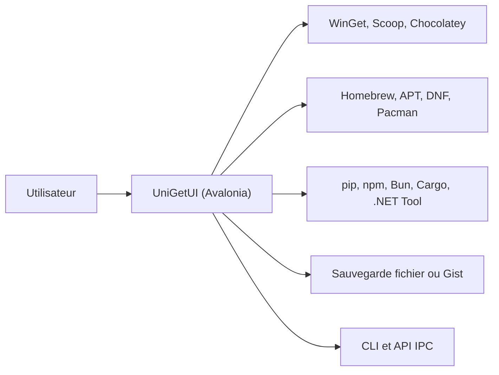

# Devolutions/UniGetUI

> Interface graphique unique pour les gestionnaires de paquets en ligne de commande, Windows en priorité.

## Le problème
Installer et mettre à jour des logiciels passe par WinGet, Scoop, Chocolatey, pip, npm, etc. : autant de commandes et d'interfaces différentes.

## Ce que ce n'est pas
Voir plus bas.

## Ce que ça fait vraiment
Découvrir, installer, mettre à jour et désinstaller des paquets de plusieurs gestionnaires depuis une seule fenêtre, en masse si besoin. Il gère les mises à jour automatiques ou ignorées par paquet, des maintenances planifiées, l'export/import de listes de paquets, la sauvegarde locale ou dans un Gist GitHub secret, un historique d'opérations, une CLI et une API IPC locale. Mode portable disponible. Les builds sont compilés en NativeAOT.

## Comment c'est branché


## Essayer
```bash
winget install --exact --id Devolutions.UniGetUI --source winget
scoop bucket add extras
scoop install extras/unigetui
choco install unigetui
```

## Coût et pièges
Gratuit, MIT. Les paquets viennent de tiers et peuvent être compromis ; le README alerte aussi sur de faux sites (wingetui•com, unigetui•com). Les antivirus peuvent signaler l'exécutable. Linux : glibc 2.27 ou plus récente.

## Ce que ce n'est pas
Pas un gestionnaire de paquets : il pilote les gestionnaires existants et n'apporte aucune vérification de sécurité propre. Le site officiel est devolutions.net/unigetui, aucun autre.

## Alternatives
WinGet, Scoop, Chocolatey, Homebrew : ce sont les outils qu'il enveloppe, à utiliser directement si tu préfères la CLI.

## Pour toi
Ignorer : confort de poste de travail, utile surtout sous Windows ; il ne répond à aucun besoin data/IA/MLOps précis.

