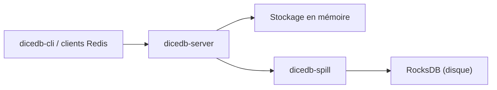

# DiceDB/dice

> Fork of Valkey (itself a fork of Redis) that adds on-disk persistence of evicted keys.

## The problem
An in-memory cache loses evicted keys: you want a working set larger than RAM without leaving the Redis ecosystem.

## What it actually does
Stays compatible with Redis/Valkey tools and SDKs. Adds the `dicedb-spill` module: it writes evicted keys to disk (RocksDB by default, 250 MB memory limit) and restores them on demand. The old reactive Go version is archived (dice-legacy); some features will be ported.

## How it is wired


## Trying it
```bash
docker run \
    --name dicedb-001 \
    -p 6379:6379 -v $(pwd)/data:/data/ \
    dicedb/dicedb
docker exec -it dicedb-001 dicedb-cli
```

## Cost and gotchas
Free. Valkey references still present in logs and code. The catalogue does not list the license; to be checked (Valkey is BSD, but the README does not say so).

## What it is not
Not the original reactive Go DiceDB, now archived. The README gives no performance figures.

## Alternatives
The README cites Valkey and Redis as compatible bases, and dice-legacy for the old version.

## For you
Watch: worth considering if you want a Redis cache that overflows to disk, but the only documented difference is this spill module.
