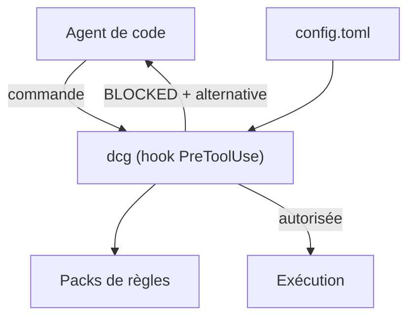

# Dicklesworthstone/destructive_command_guard

> Rust hook that blocks destructive commands run by coding agents before they execute.

## The problem
A coding agent can run `git reset --hard`, `rm -rf ./src` or `DROP TABLE users` and destroy hours of unsaved work.

## What it actually does
dcg sits as a hook before command execution in Claude Code, Codex CLI, Gemini CLI, Cursor, OpenCode and others. It blocks with an explanation and a safer alternative. It relies on rule "packs" (more than fifty: databases, Kubernetes, Docker, clouds, Terraform), distinguishes data from execution (`grep "rm -rf"` passes) and scans inline scripts. Only the `core.filesystem`, `core.git` and `system.disk` packs are active by default.

## How it is wired

Simplified diagram based on the write-up, no diagram provided.

## Trying it
```bash
dcg explain "git reset --hard HEAD~5"
dcg packs
DCG_BYPASS=1 <commande>
```

## Cost and gotchas
Free. The README states a license is present but not identified by GitHub: to be verified. `DCG_BYPASS=1` disables all protection for a command. A global `warn` is raised to `deny` for critical rules: you need one entry per rule. The README provided is truncated in the list of packs: the rest is not read.

## What it is not
It is not a sandbox: it filters command patterns, it does not isolate execution. Aider is covered only by git hooks, and Continue by detection only.

## Alternatives
The README names no alternative.

## For you
Adopt it if you let agents touch your repos, databases or clusters: a lightweight safeguard, but check the license.
