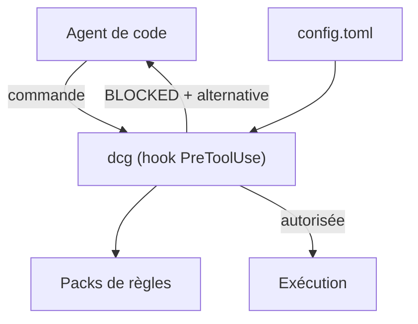

# Dicklesworthstone/destructive_command_guard

> Hook en Rust qui bloque les commandes destructrices lancées par les agents de code avant leur exécution.

## Le problème
Un agent de code peut lancer `git reset --hard`, `rm -rf ./src` ou `DROP TABLE users` et détruire des heures de travail non sauvegardé.

## Ce que ça fait vraiment
dcg s'intercale comme hook avant l'exécution des commandes de Claude Code, Codex CLI, Gemini CLI, Cursor, OpenCode et d'autres. Il bloque avec une explication et une alternative plus sûre. Il repose sur des « packs » de règles (plus de cinquante : bases de données, Kubernetes, Docker, clouds, Terraform), distingue la donnée de l'exécution (`grep "rm -rf"` passe) et scanne les scripts inline. Seuls les packs `core.filesystem`, `core.git` et `system.disk` sont actifs par défaut.

## Comment c'est branché

Schéma simplifié d'après la fiche, sans diagramme fourni.

## Essayer
```bash
dcg explain "git reset --hard HEAD~5"
dcg packs
DCG_BYPASS=1 <commande>
```

## Coût et pièges
Gratuit. Le README annonce une licence présente mais non identifiée par GitHub : à vérifier. `DCG_BYPASS=1` désactive toute protection pour une commande. Un `warn` global est relevé en `deny` pour les règles critiques : il faut une entrée par règle. Le README fourni est tronqué dans la liste des packs : le reste n'est pas lu.

## Ce que ce n'est pas
Ce n'est pas un bac à sable : il filtre des motifs de commandes, il n'isole pas l'exécution. Aider n'est couvert que par des hooks git, et Continue en détection seulement.

## Alternatives
Le README ne cite pas d'alternative nommée.

## Pour toi
À adopter si tu laisses des agents toucher à tes dépôts, bases ou clusters : garde-fou léger, mais vérifie la licence.

