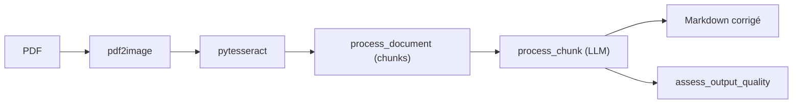

# Dicklesworthstone/llm_aided_ocr

> Script that corrects Tesseract OCR output with an LLM and reformats it as Markdown.

## The problem
Tesseract leaves errors, hyphenations and headers that pollute the text extracted from a PDF.

## What it actually does
Converts the PDF to images, applies Tesseract, splits the text into overlapping chunks, has an LLM correct each chunk (local llama.cpp, OpenAI or Anthropic), reformats as Markdown removing duplicates, headers and page numbers, then evaluates quality with an LLM score. Asynchronous processing for the APIs. Outputs: `_raw_ocr_output.txt` and `_llm_corrected.md`.

## How it is wired


## Trying it
```bash
git clone https://github.com/Dicklesworthstone/llm_aided_ocr
cd llm_aided_ocr
python -m venv venv && source venv/bin/activate
pip install -r requirements.txt
sudo apt-get install tesseract-ocr
python llm_aided_ocr.py
```

## Cost and gotchas
OpenAI or Anthropic key on you, or a local GGUF. Python 3.12+. The PDF path must be edited in `main()`. License not identified by GitHub.

## What it is not
Not an OCR: quality depends on the LLM and on a Tesseract already run. An LLM can "correct" by rewriting; the README mentions no safeguard.

## Alternatives
Not documented in the README.

## For you
Worth watching: the OCR-then-LLM-correction pattern is reusable, but this is a script to adapt, not a stabilized tool.
