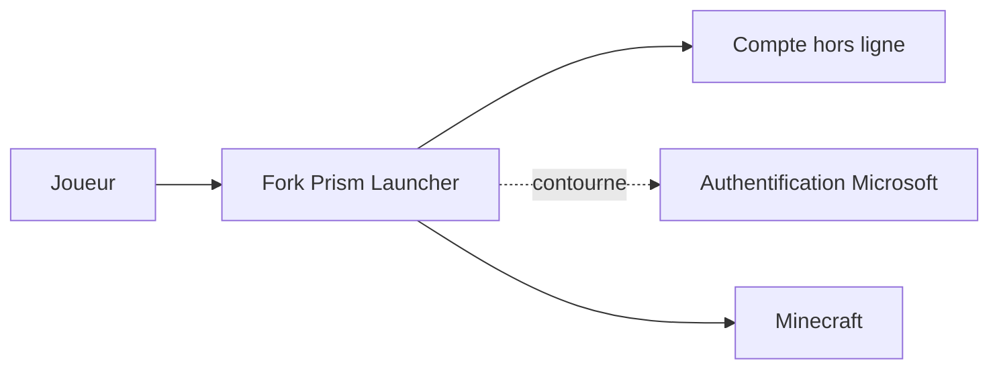

# Diegiwg/PrismLauncher-Cracked

> Fork of Prism Launcher that lets you play Minecraft offline, without a Microsoft account.

## The problem
The official launcher requires Microsoft authentication to start the game.

## What it actually does
It is a fork of Prism Launcher that adds offline accounts. It bypasses authentication. The README states use is reserved for offline play and says nothing more: a download page and a warning.

## How it is wired
Simplified diagram based on the sheet, no diagram provided.

## Trying it
No command documented. The README points to the Releases page to download the latest version.

## Cost and gotchas
Free. The README forbids using an official Microsoft or Mojang account, and warns that use on official servers may violate Minecraft's terms.

## What it is not
It is not the official project (unaffiliated). It is not a data or AI tool. README under 800 characters: documentation is nearly absent.

## Alternatives
No alternative named in the README (it only cites Prism Launcher, of which it is the fork).

## For you
Ignore: unrelated to your field, and it serves to bypass authentication, with a terms-of-use risk.
