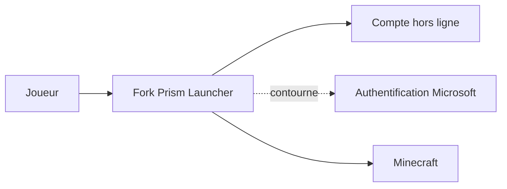

# Diegiwg/PrismLauncher-Cracked

> Fork de Prism Launcher qui permet de jouer à Minecraft hors ligne, sans compte Microsoft.

## Le problème
Le lanceur officiel exige une authentification Microsoft pour lancer le jeu.

## Ce que ça fait vraiment
C'est un fork de Prism Launcher qui ajoute des comptes hors ligne. Il contourne l'authentification. Le README annonce un usage réservé au jeu hors ligne et ne dit rien de plus : une page de téléchargement et un avertissement.

## Comment c'est branché
Schéma simplifié d'après la fiche, sans diagramme fourni.

## Essayer
Aucune commande documentée. Le README renvoie vers la page des Releases pour télécharger la dernière version.

## Coût et pièges
Gratuit. Le README interdit d'utiliser un compte Microsoft ou Mojang officiel, et prévient qu'un usage sur serveurs officiels peut violer les conditions de Minecraft.

## Ce que ce n'est pas
Ce n'est pas le projet officiel (non affilié). Ce n'est pas un outil de data ou d'IA. README de moins de 800 caractères : la documentation est quasi absente.

## Alternatives
Aucune alternative nommée dans le README (il cite seulement Prism Launcher, dont il est le fork).

## Pour toi
À ignorer : sans rapport avec ton métier, et il sert à contourner une authentification, avec un risque de conditions d'usage.

