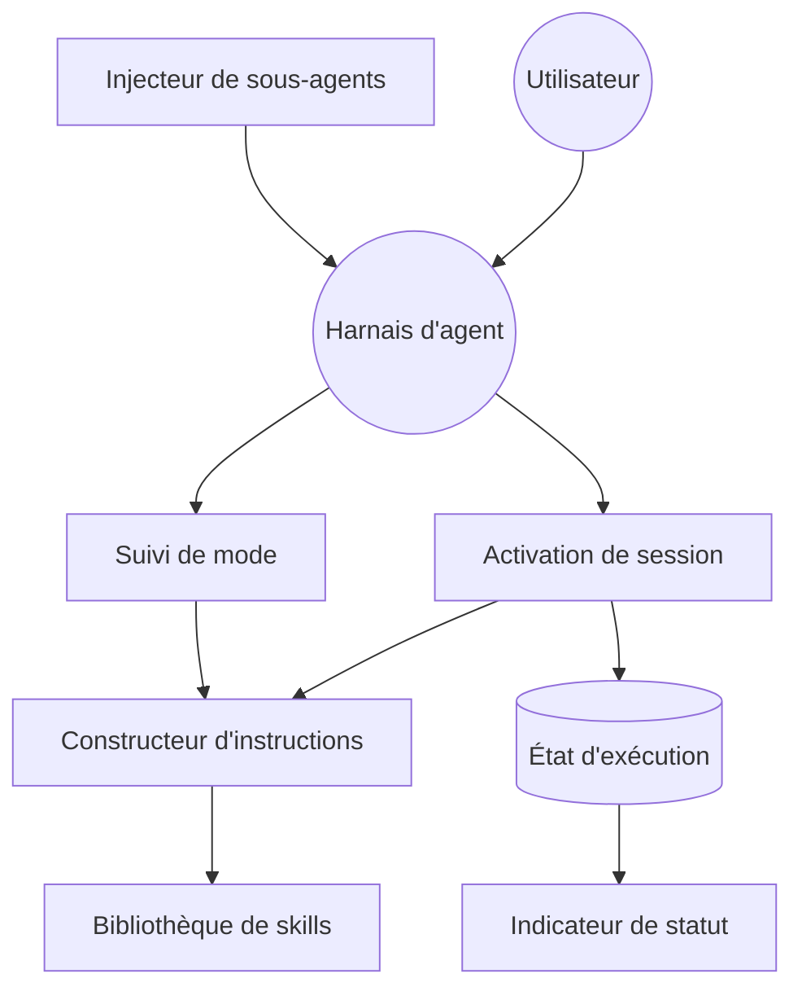

# DietrichGebert/ponytail

> A rule is injected into a code agent to ensure that it writes the minimum amount of code required.

## The problem
An over-engineered code snippet: it installs a dependency where a native HTML tag would suffice.

The result is longer to read, more expensive in terms of tokens, and more costly to maintain.

## What it actually does
Include a seven-question checklist before each generation: Is it necessary, does it already exist, does stdlib provide it, etc.
Four levels of intensity (lite, full, ultra, off) that can be adjusted during a session or via an environment variable.
Six commands: diff review, repository audit, debt ledger, gains table, help.
Adapters for around twenty harnesses; the rule also applies to sub-agents.

## How it is wired


## Trying it
```bash
codex plugin marketplace add DietrichGebert/ponytail
codex plugin add ponytail@ponytail
node scripts/check-rule-copies.js
npm test
```

## Cost and gotchas
Free. The `node` command must be in the non-interactive PATH, otherwise the permanent activation will remain inactive.
Uninstalling leaves status files outside the plugin directory; `node scripts/uninstall.js` removes them.

## What it is not
Not a linter: nothing is checked afterward; it's a generation instruction.
The figures announced (-54% of LOC) come from a single benchmark of 12 tasks on a single codebase, using Haiku 4.5.
On a verbose reasoning model, the cost effect can be reversed – the README states this for GPT-5.5.

## Alternatives
- `addyosmani/agent-skills` covers the entire cycle, including a skill for simplification.
- `affaan-m/ECC`: Same logic of injected rules, but on a much larger scale.

## For you
One simple rule, easily measured and removed. A good benefit-to-risk ratio that can be tested on a real project.
