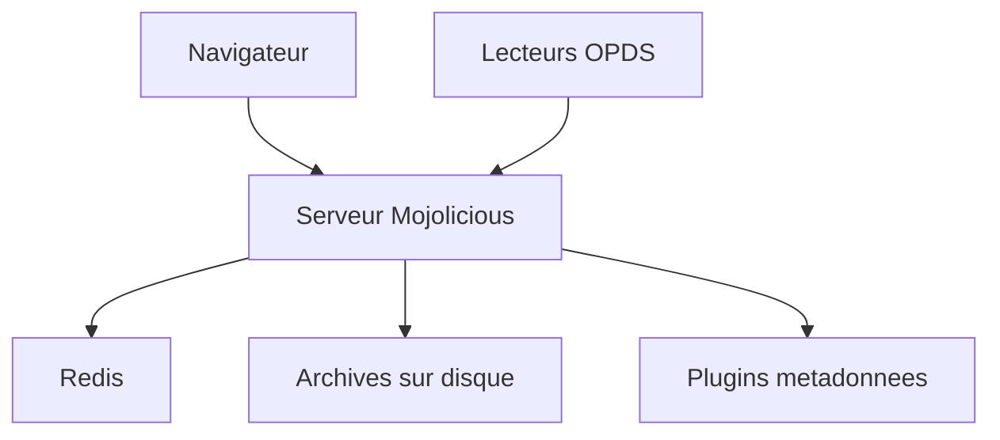

# Difegue/LANraragi

> Open-source server to archive and read your comics and manga in the browser, built on Mojolicious and Redis.

## The problem
A collection of comics scattered across zip/rar archives is hard to browse, tag and read remotely.

## What it actually does
Stores archives (zip, rar, targz, 7z, cbz, cbr, pdf…) and reads them in the browser without durably extracting them. OPDS catalog, client API, namespaced tags, categories, metadata import through plugins, direct download, duplicate detection, JSON backup of the database. Interface in 11 languages.

## How it is wired

## Trying it
No command documented in this README (installation is referred to the documentation).

## Cost and gotchas
Free. Redis required (per the README, server built on Mojolicious + Redis); the metadata plugins query external sources.

## What it is not
Not a watch or data tool: it is a personal reading library.

## Alternatives
No alternative named in the README.

## For you
Ignore: leisure use, unrelated to data/AI/MLOps work.
