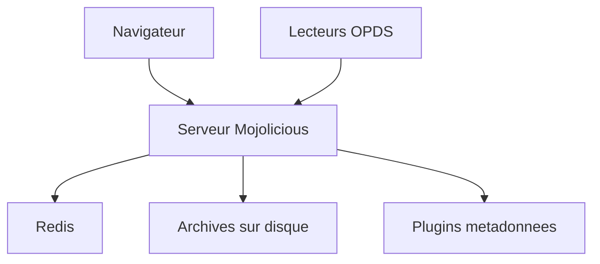

# Difegue/LANraragi

> Serveur open source pour archiver et lire ses comics et mangas dans le navigateur, sur Mojolicious et Redis.

## Le problème
Une collection de comics en archives zip/rar dispersés est difficile à parcourir, tagger et lire à distance.

## Ce que ça fait vraiment
Stocke les archives (zip, rar, targz, 7z, cbz, cbr, pdf…) et les lit dans le navigateur sans les extraire durablement. Catalogue OPDS, API client, tags avec espaces de noms, catégories, import de métadonnées par plugins, téléchargement direct, détection de doublons, sauvegarde JSON de la base. Interface en 11 langues.

## Comment c'est branché

## Essayer
Aucune commande documentée dans ce README (installation renvoyée à la documentation).

## Coût et pièges
Gratuit. Redis requis (selon le README, serveur sur Mojolicious + Redis) ; les plugins de métadonnées interrogent des sources externes.

## Ce que ce n'est pas
Pas un outil de veille ni de data : c'est une bibliothèque personnelle de lecture.

## Alternatives
Aucune alternative nommée dans le README.

## Pour toi
À ignorer : usage de loisir, sans rapport avec le travail data/IA/MLOps.

