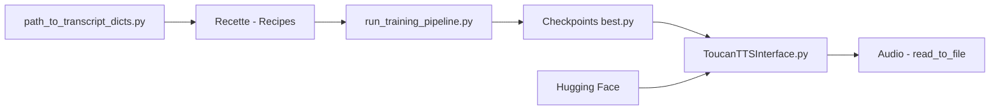

# DigitalPhonetics/IMS-Toucan

> Multilingual speech synthesis toolkit (over 7000 languages) for training and using ToucanTTS.

## The problem
Existing synthetic voices cover few languages and require large corpora and significant compute.

## What it actually does
Repository from the University of Stuttgart. Inference via `InferenceInterfaces/ToucanTTSInterface.py` (`read_to_file`, `read_aloud`) with control of duration, pitch, energy, language and voice. Training through "recipes" in `TrainingInterfaces/Recipes`, launched by `run_training_pipeline.py`, multi-GPU via torchrun, optional Weights & Biases tracking. A scorer flags high-loss samples. Models are downloaded from Hugging Face.

## How it is wired


## Trying it
```bash
python -m venv <path_to_where_you_want_your_env_to_be>
source <path_to_where_you_want_your_env_to_be>/bin/activate
pip install --no-cache-dir -r requirements.txt
python run_training_pipeline.py <shorthand of the pipeline> --gpu_id 0
```

## Cost and gotchas
Free. CUDA GPU for training (not needed for inference). System packages: espeak-ng, ffmpeg, libsndfile1, etc. macOS installation is complicated. Last push January 2026.

## What it is not
Not a ready-to-use service: the repository is a research kit. The README gives no quality measurement.

## Alternatives
None named in the README.

## For you
Worth watching: useful if you need TTS for low-resource languages; the Hugging Face demo lets you try it without installing anything.
