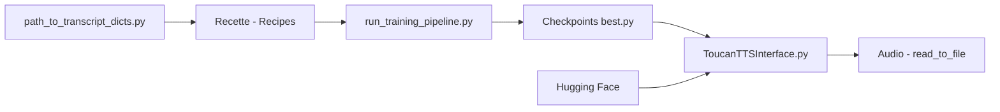

# DigitalPhonetics/IMS-Toucan

> Boîte à outils de synthèse vocale multilingue (plus de 7000 langues) pour entraîner et utiliser ToucanTTS.

## Le problème
Les voix de synthèse existantes couvrent peu de langues et demandent des corpus et une puissance de calcul importants.

## Ce que ça fait vraiment
Dépôt de l'Université de Stuttgart. Inférence via `InferenceInterfaces/ToucanTTSInterface.py` (`read_to_file`, `read_aloud`) avec réglage de durée, hauteur, énergie, langue et voix. Entraînement par « recettes » dans `TrainingInterfaces/Recipes`, lancées par `run_training_pipeline.py`, multi-GPU via torchrun, suivi Weights & Biases optionnel. Un scorer repère les échantillons à forte perte. Les modèles se téléchargent depuis Hugging Face.

## Comment c'est branché


## Essayer
```bash
python -m venv <path_to_where_you_want_your_env_to_be>
source <path_to_where_you_want_your_env_to_be>/bin/activate
pip install --no-cache-dir -r requirements.txt
python run_training_pipeline.py <shorthand of the pipeline> --gpu_id 0
```

## Coût et pièges
Gratuit. GPU CUDA pour entraîner (inutile pour l'inférence). Paquets système : espeak-ng, ffmpeg, libsndfile1, etc. Installation macOS compliquée. Dernier push janvier 2026.

## Ce que ce n'est pas
Pas un service prêt à l'emploi : le dépôt est un kit de recherche. Le README ne donne pas de mesure de qualité.

## Alternatives
Aucune nommée dans le README.

## Pour toi
Surveiller : utile si tu as besoin de TTS pour des langues peu dotées ; la démo Hugging Face permet d'essayer sans installation.

