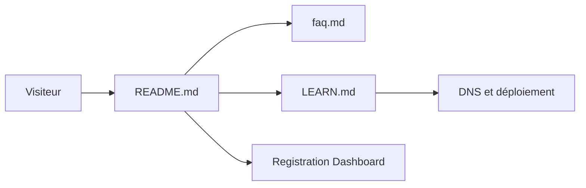

# DigitalPlatDev/FreeDomain

> Information page and DNS guide for a free subdomain service; for those who want an address without paying.

## The problem
Owning a domain name involves costs, which can hinder personal projects or demos. DNS, website hosting, and email setup are also areas that beginners often find confusing.

## What it actually does
This repository contains only public information: FAQs, announcements, tutorials, and a learning guide (LEARN.md). Registration is done through an external dashboard, using extensions like .DPDNS.ORG or .US.KG. The application code is in a separate repository (Domain-OSS). The guide covers DNS, website deployment, email, and operation.

## How it is wired


## Trying it
```bash
# aucune commande documentée : l'enregistrement passe par le tableau de bord web
```

## Cost and gotchas
Free to use, with a simple account creation process on the dashboard. The service relies on a single provider, and any extensions you use are not yours.

## What it is not
This is not the application code (a separate repository). It's not a standard registrar: your names remain subject to the rules and abuse reporting procedures of the service.

## Alternatives
No alternative is specified in the README file.

## For you
Things to watch out for: useful for a proof-of-concept or a temporary demo, but too fragile to host a permanent data service or model endpoint.
