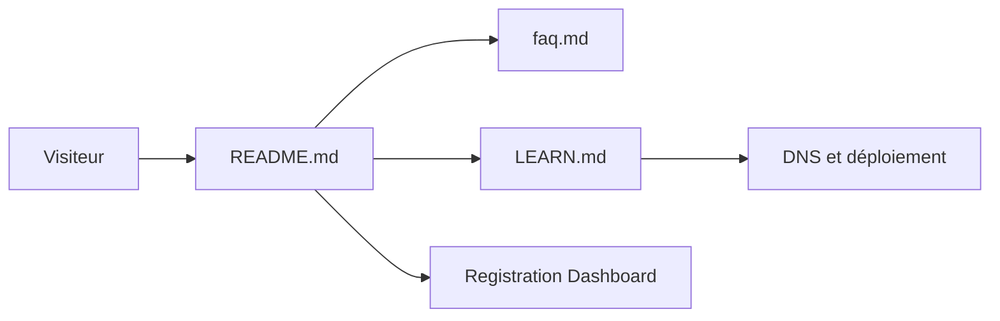

# DigitalPlatDev/FreeDomain

> Page d'information et guide DNS d'un service de sous-domaines gratuits ; pour qui veut une adresse sans payer.

## Le problème
Un domaine coûte de l'argent, ce qui freine un projet perso ou une démo. Le DNS, la mise en ligne et l'e-mail sont mal connus des débutants.

## Ce que ça fait vraiment
Ce dépôt ne contient que l'information publique : FAQ, annonces, tutoriel et un guide d'apprentissage (LEARN.md). L'enregistrement se fait sur un tableau de bord externe, avec des extensions comme .DPDNS.ORG ou .US.KG. Le code de l'application est dans un autre dépôt (Domain-OSS). Le guide couvre DNS, déploiement de site, e-mail et exploitation.

## Comment c'est branché


## Essayer
```bash
# aucune commande documentée : l'enregistrement passe par le tableau de bord web
```

## Coût et pièges
Gratuit, compte à créer sur le tableau de bord. Le service dépend d'un opérateur unique et les extensions ne t'appartiennent pas.

## Ce que ce n'est pas
Pas le code de l'application (autre dépôt). Pas un registrar classique : tes noms restent soumis aux règles et au signalement d'abus du service.

## Alternatives
Aucune alternative nommée dans le README.

## Pour toi
À surveiller : utile pour un POC ou une démo jetable, trop fragile pour héberger un service de données ou un endpoint de modèle durable.

