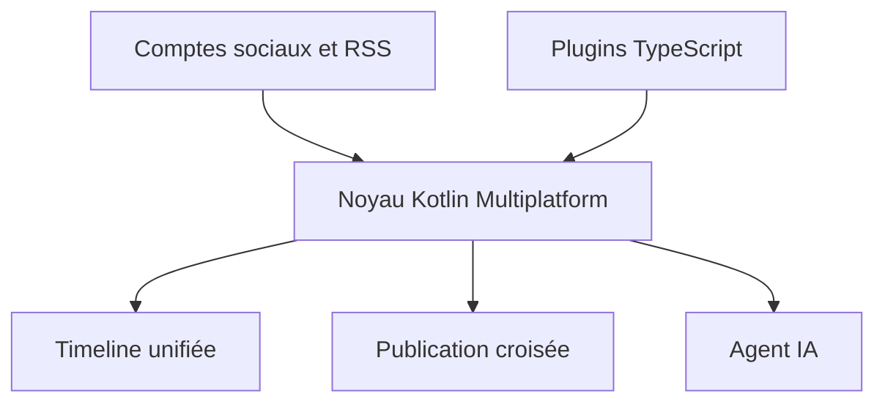

# DimensionDev/Flare

> Cross-platform social client that brings Mastodon, Bluesky, X, RSS and others into a single timeline.

## The problem
Following several social networks means juggling as many applications.

## What it actually does
Flare merges Mastodon, Misskey, Bluesky, X, Pixiv, Fanbox, Nostr and RSS into a single feed, with cross-posting, lists, bookmarks, direct messages. An AI agent (OpenAI-compatible service or local model) summarizes and replies using the local cache. TypeScript plugins in beta add other sites. Written in Kotlin Multiplatform for Android, iOS, macOS, Windows, Linux.

## How it is wired
Simplified diagram based on the sheet, no diagram provided.



## Trying it
```bash
npx flare-plugin-sdk@next init my-plugin
```
This command creates a plugin; no command to install the app is given.

## Cost and gotchas
Free. The AI agent requires your own key or a local model. Plugins are added from a public GitHub repository: review them before accepting.

## What it is not
It is not an automated monitoring tool: it is a reading and publishing client.

## Alternatives
No alternative named in the README.

## For you
Ignore: general-purpose social client; its local AI agent is interesting but secondary for your work.
