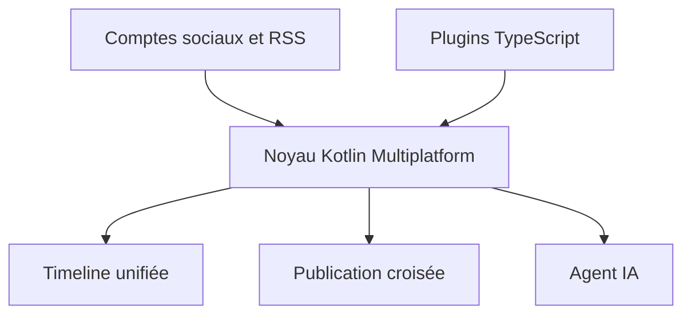

# DimensionDev/Flare

> Client social multiplateforme qui réunit Mastodon, Bluesky, X, RSS et d'autres en une seule timeline.

## Le problème
Suivre plusieurs réseaux sociaux oblige à jongler entre autant d'applications.

## Ce que ça fait vraiment
Flare fusionne Mastodon, Misskey, Bluesky, X, Pixiv, Fanbox, Nostr et RSS dans un fil unique, avec publication croisée, listes, favoris, messages privés. Un agent IA (service compatible OpenAI ou modèle local) résume et répond sur le cache local. Des plugins TypeScript en bêta ajoutent d'autres sites. Écrit en Kotlin Multiplatform pour Android, iOS, macOS, Windows, Linux.

## Comment c'est branché
Schéma simplifié d'après la fiche, sans diagramme fourni.



## Essayer
```bash
npx flare-plugin-sdk@next init my-plugin
```
Cette commande crée un plugin ; aucune commande d'installation de l'app n'est donnée.

## Coût et pièges
Gratuit. L'agent IA demande ta propre clé ou un modèle local. Les plugins s'ajoutent depuis un dépôt GitHub public : à relire avant d'accepter.

## Ce que ce n'est pas
Ce n'est pas un outil de veille automatisée : c'est un client de lecture et de publication.

## Alternatives
Aucune alternative nommée dans le README.

## Pour toi
À ignorer : client social généraliste ; son agent IA local est intéressant mais secondaire pour ton métier.

