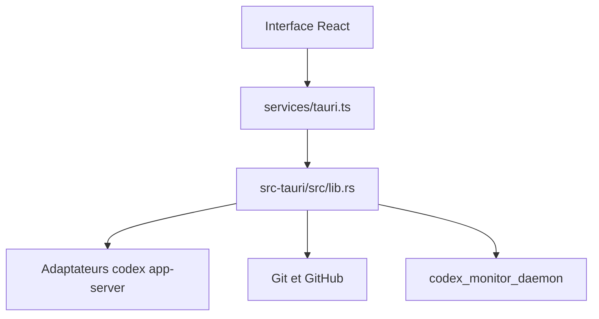

# Dimillian/CodexMonitor

> Tauri application for orchestrating several Codex agents on local workspaces.

## The problem
Driving several Codex sessions across several projects from separate terminals gets confusing.

## What it actually does
Launches one `codex app-server` per workspace and displays conversations, threads, worktrees, Git diffs, GitHub issues and PRs (via `gh`) and a prompt library. Offers dictation (Whisper), an integrated terminal, a remote daemon and iOS access via Tailscale.

## How it is wired


## Trying it
```bash
npm install
npm run tauri:dev
npm run tauri:build
```

## Cost and gotchas
Free. Requires Node, a Rust toolchain, CMake, the Codex CLI in the `PATH` and, on Windows, LLVM/Clang. The iOS build requires Xcode and Apple signing.

## What it is not
It is not an agent: it drives the Codex CLI, which you must install and authenticate. The last push dates from March 2026, less than eight months before the write-up, so no staleness alert.

## Alternatives
No alternative named in the README.

## For you
Ignore unless you use Codex heavily: a convenience tool from a single maintainer, tied to an external CLI.
