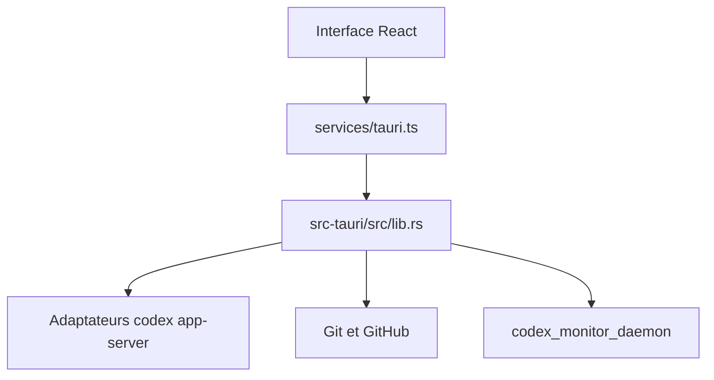

# Dimillian/CodexMonitor

> Application Tauri pour orchestrer plusieurs agents Codex sur des espaces de travail locaux.

## Le problème
Piloter plusieurs sessions Codex sur plusieurs projets depuis des terminaux séparés devient confus.

## Ce que ça fait vraiment
Lance un `codex app-server` par espace de travail et affiche les conversations, les fils, les worktrees, les diffs Git, les issues et PR GitHub (via `gh`) et une bibliothèque de prompts. Offre la dictée (Whisper), un terminal intégré, un démon distant et un accès iOS via Tailscale.

## Comment c'est branché


## Essayer
```bash
npm install
npm run tauri:dev
npm run tauri:build
```

## Coût et pièges
Gratuit. Il faut Node, une chaîne Rust, CMake, le CLI Codex dans le `PATH` et, sous Windows, LLVM/Clang. La build iOS demande Xcode et une signature Apple.

## Ce que ce n'est pas
Ce n'est pas un agent : il pilote le CLI Codex, qu'il faut installer et authentifier. Le dernier push date de mars 2026, moins de huit mois avant la fiche, donc sans alerte d'ancienneté.

## Alternatives
Aucune alternative nommée dans le README.

## Pour toi
Ignorer sauf usage intensif de Codex : outil de confort d'un seul mainteneur, lié à un CLI externe.

