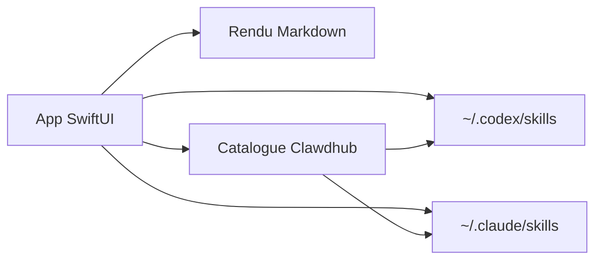

# Dimillian/CodexSkillManager

> macOS app that browses, displays and installs the local skills of Codex and Claude Code.

## The problem
Skills are `SKILL.md` folders scattered across `~/.codex` and `~/.claude`; hard to see, import or delete them.

## What it actually does
SwiftUI app (SwiftPM, no Xcode project): list of local skills, Markdown rendering of `SKILL.md` with reference previews, import from a folder or zip, deletion, browsing of the remote Clawdhub catalog, download to Codex and/or Claude Code, installed-state and version labels.

## How it is wired


## Trying it
```bash
swift build
swift run CodexSkillManager
./Scripts/compile_and_run.sh
```

## Cost and gotchas
Free. Requires macOS 26 and Swift 6.2: a very recent setup. Last push in January 2026: modest activity.

## What it is not
Not cross-platform, not a command-line installer. The Clawdhub catalog is a third-party service.

## Alternatives
No alternative named in the README.

## For you
Worth watching: only handy on a Mac for taking stock of your skills; a plain `ls` is enough if you only have a few.
