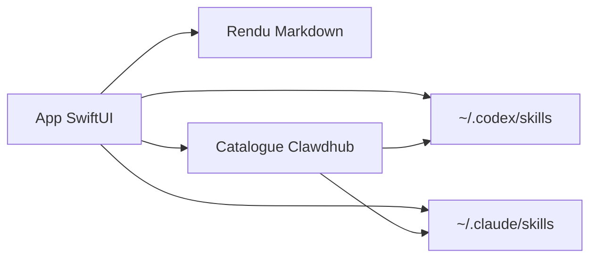

# Dimillian/CodexSkillManager

> Application macOS qui parcourt, affiche et installe les skills locaux de Codex et Claude Code.

## Le problème
Les skills sont des dossiers `SKILL.md` éparpillés dans `~/.codex` et `~/.claude` ; difficile de les voir, les importer ou les supprimer.

## Ce que ça fait vraiment
Application SwiftUI (SwiftPM, sans projet Xcode) : liste des skills locaux, rendu Markdown de `SKILL.md` avec aperçus de références, import depuis dossier ou zip, suppression, navigation du catalogue distant Clawdhub, téléchargement vers Codex et/ou Claude Code, étiquettes d'état installé et de version.

## Comment c'est branché


## Essayer
```bash
swift build
swift run CodexSkillManager
./Scripts/compile_and_run.sh
```

## Coût et pièges
Gratuit. Exige macOS 26 et Swift 6.2 : une configuration très récente. Dernier push en janvier 2026 : activité modeste.

## Ce que ce n'est pas
Pas multiplateforme, pas un installeur en ligne de commande. Le catalogue Clawdhub est un service tiers.

## Alternatives
Aucune alternative nommée dans le README.

## Pour toi
À surveiller : pratique seulement sur Mac pour inventorier tes skills ; un `ls` suffit si tu n'en as que quelques-uns.

