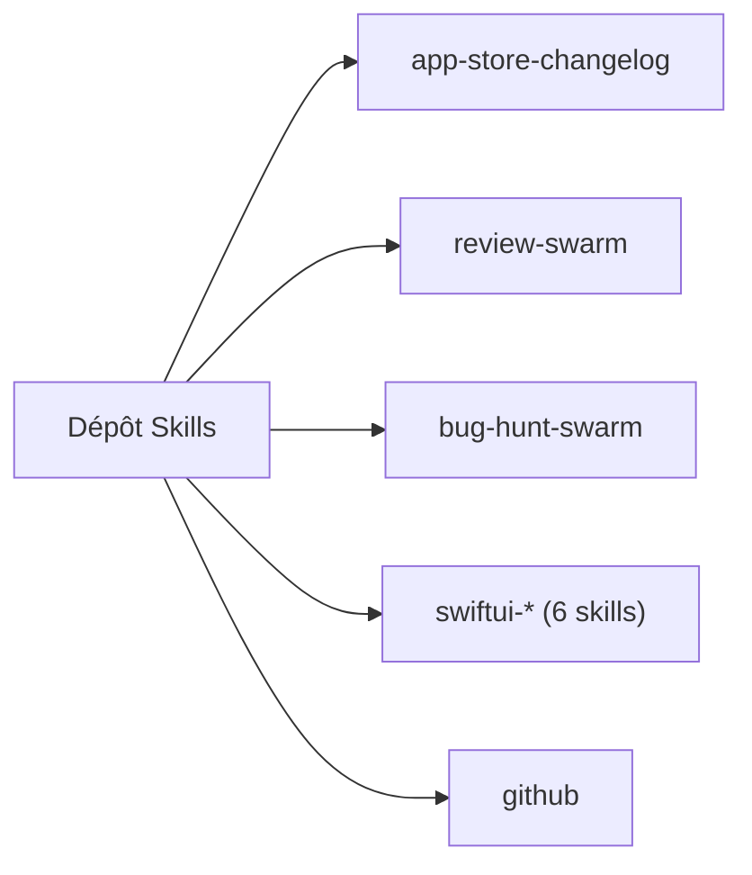

# Dimillian/Skills

> Sixteen reusable skills for Apple developers, code reviews, refactorings and GitHub workflows.

## The problem
Recurring engineering tasks (release notes, diff review, SwiftUI audit) are redone by hand on every project.

## What it actually does
Collects sixteen standalone skills, each with a `SKILL.md`: App Store notes, GitHub via `gh`, iOS debugging with XcodeBuildMCP, macOS packaging, SwiftUI and Swift concurrency, React performance, diff review and simplification, review and bug-hunting agent swarms, skill audit.

## How it is wired
Simplified diagram based on the sheet, no diagram provided.

## Trying it
No command documented: the README says to place the skill folders under `$CODEX_HOME/skills`.

## Cost and gotchas
Free. The skills consume the tokens of the agent that runs them. The swarm skills launch several agents in parallel.

## What it is not
It is not a tool installable with one command, nor a data tool: most target Swift, SwiftUI and macOS. Last push in March 2026.

## Alternatives
No alternative named in the README.

## For you
Ignore: mostly Apple and Swift oriented; only the diff review and bug-hunting skills might be reusable elsewhere.
