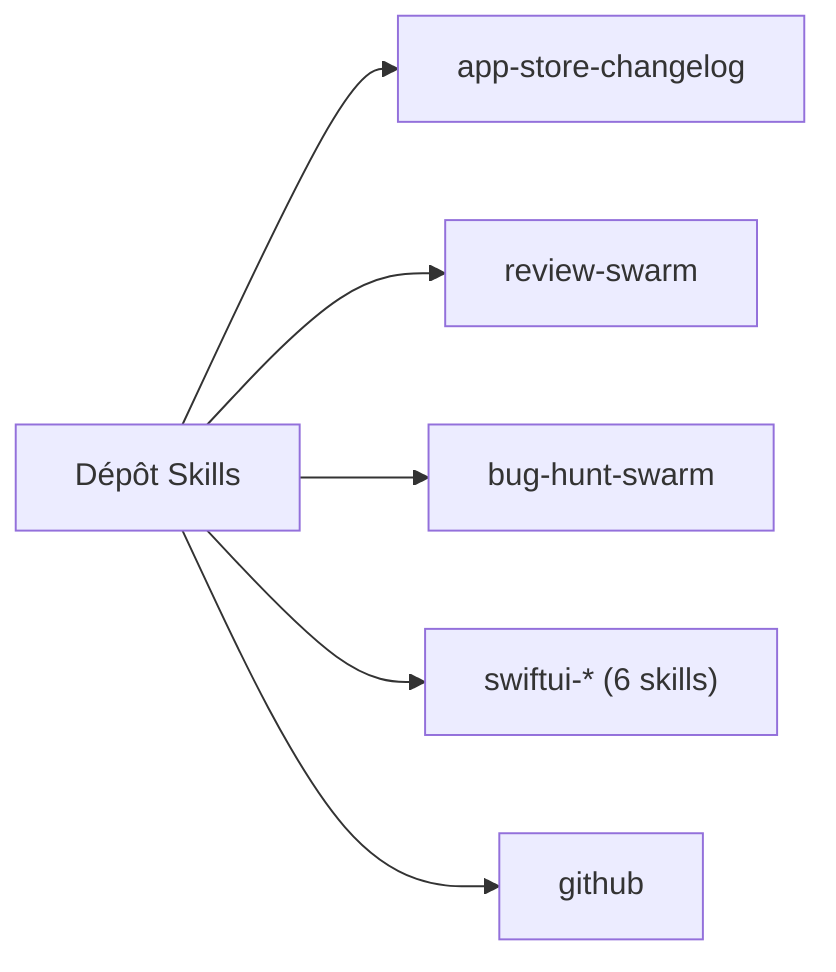

# Dimillian/Skills

> Seize skills réutilisables pour développeurs Apple, revues de code, refactorings et workflows GitHub.

## Le problème
Les tâches d'ingénierie récurrentes (notes de version, revue de diff, audit SwiftUI) sont refaites à la main à chaque projet.

## Ce que ça fait vraiment
Collecte seize skills autonomes, chacun avec un `SKILL.md` : notes App Store, GitHub via `gh`, débogage iOS avec XcodeBuildMCP, packaging macOS, SwiftUI et concurrence Swift, performance React, revue et simplification de diffs, essaims d'agents de revue et de chasse aux bugs, audit de skills.

## Comment c'est branché
Schéma simplifié d'après la fiche, sans diagramme fourni.

## Essayer
Aucune commande documentée : le README indique de placer les dossiers de skills sous `$CODEX_HOME/skills`.

## Coût et pièges
Gratuit. Les skills consomment les jetons de l'agent qui les exécute. Les skills d'essaim lancent plusieurs agents en parallèle.

## Ce que ce n'est pas
Ce n'est pas un outil installable avec une commande, ni un outil data : la plupart ciblent Swift, SwiftUI et macOS. Dernier push en mars 2026.

## Alternatives
Aucune alternative nommée dans le README.

## Pour toi
À ignorer : surtout orienté Apple et Swift ; seuls les skills de revue de diff et de chasse aux bugs peuvent resservir ailleurs.

