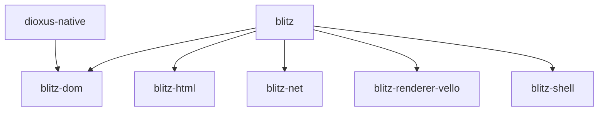

# DioxusLabs/blitz

> Modular HTML/CSS rendering engine in Rust, in beta, for native applications without a full browser.

## The problem
A whole browser is too heavy when you only want to display HTML/CSS in a native application.

## What it actually does
It provides a DOM (`blitz-dom`, with style, layout and events), HTML parsing, rendering through AnyRender, a window shell (Winit, AccessKit) and networking. Two wrappers: `blitz` (HTML/Markdown, no interactivity) and `dioxus-native` (interactive Dioxus application). It offers no WebRTC, no WebSocket, no localStorage.

## How it is wired
Diagram based on the one provided.



## Trying it
```bash
cargo run -rp browser
cargo run -rp rdme ./README.md
cargo run -rp todomvc
cargo run -rp wgpu_texture
```

## Cost and gotchas
Free. Beta: bugs and missing features, 393 open issues. The AnyRender engine lives in another repository.

## What it is not
Not a browser: no JavaScript, no rich Web API. No bindings for other languages.

## Alternatives
No alternative named in the README.

## For you
Keep an eye on it: worth following if you aim at native Rust interfaces, but too young and too far from data to commit to.
