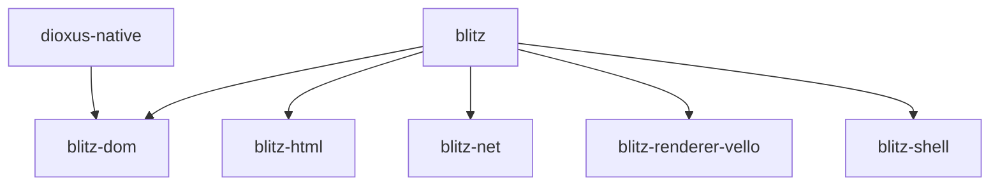

# DioxusLabs/blitz

> Moteur de rendu HTML/CSS modulaire en Rust, en bêta, pour applications natives sans navigateur complet.

## Le problème
Un navigateur entier est trop lourd quand on veut seulement afficher du HTML/CSS dans une application native.

## Ce que ça fait vraiment
Il fournit un DOM (`blitz-dom`, avec style, mise en page et événements), l'analyse HTML, le rendu via AnyRender, un shell de fenêtre (Winit, AccessKit) et le réseau. Deux enveloppes : `blitz` (HTML/Markdown, sans interactivité) et `dioxus-native` (application Dioxus interactive). Il n'offre ni WebRTC, ni WebSocket, ni localStorage.

## Comment c'est branché
Schéma d'après le diagramme fourni.



## Essayer
```bash
cargo run -rp browser
cargo run -rp rdme ./README.md
cargo run -rp todomvc
cargo run -rp wgpu_texture
```

## Coût et pièges
Gratuit. Bêta : bugs et fonctions manquantes, 393 issues ouvertes. Le moteur AnyRender vit dans un autre dépôt.

## Ce que ce n'est pas
Pas un navigateur : pas de JavaScript, pas d'API Web riche. Pas de liaisons pour d'autres langages.

## Alternatives
Aucune alternative nommée dans le README.

## Pour toi
À surveiller : à suivre si tu vises des interfaces natives en Rust, mais trop jeune et trop éloigné de la donnée pour t'engager.

