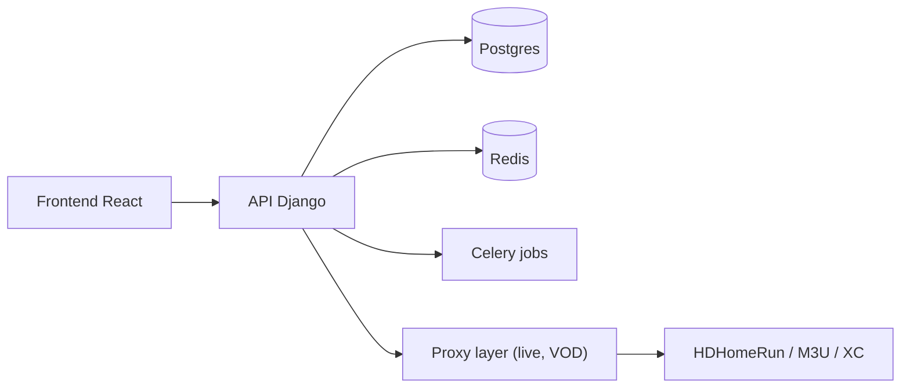

# Dispatcharr/Dispatcharr

> Self-hosted server that centralizes IPTV streams, EPG guides and VOD for Plex, Emby and Jellyfin.

## The problem
Juggling multiple IPTV providers, playlists and guides makes managing channels and recordings difficult.

## What it actually does
Django monolith with a React front end: M3U/Xtream Codes import, EPG matching, stream proxy with failover, DVR, VOD, HDHomeRun emulation, FFmpeg transcoding profiles, multi-user accounts, plugins and webhooks. Celery, Redis (pub/sub), Postgres.

## How it is wired


## Trying it
```bash
docker pull ghcr.io/dispatcharr/dispatcharr:latest
docker run -d \
  -p 9191:9191 \
  --name dispatcharr \
  -v dispatcharr_data:/data \
  ghcr.io/dispatcharr/dispatcharr:latest
```

## Cost and gotchas
You must bring your own IPTV subscriptions. The first web setup is restricted to private networks by default; behind a proxy, set `DISPATCHARR_TRUSTED_PROXIES`.

## What it is not
Provides no content. Building from source is "not officially supported".

## Alternatives
- No alternative cited in the README.

## For you
Ignore: a home media-center tool, unrelated to data/AI/MLOps work.
