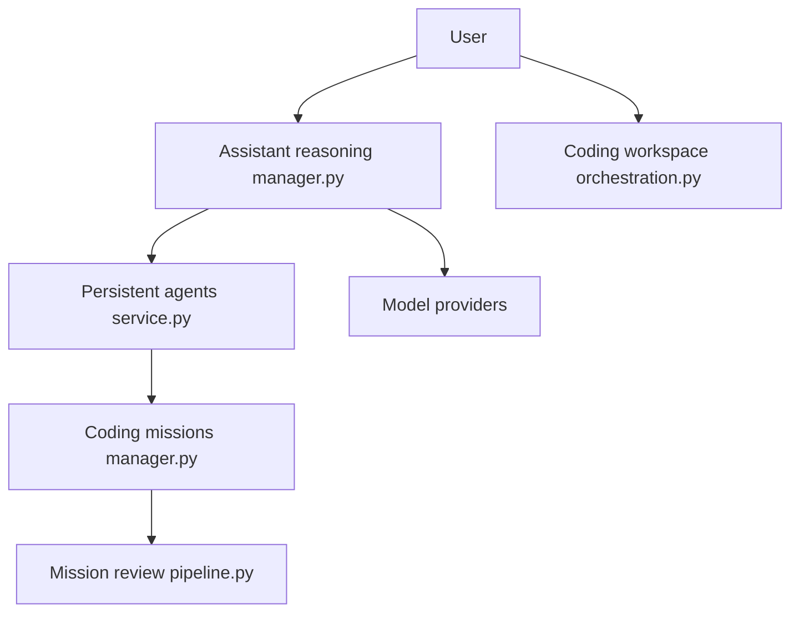

# Dodaios/Dodaios

> Desktop app that orchestrates several coding agents from a single chat, tech-lead style.

## The problem
With ten terminals, Claude Code here and Codex there, you copy context around, rewrite the same prompts and lose track of who changed what.

## What it actually does
A local assistant (with a voice wake word) writes the briefs, launches coding agents in an agentic IDE, monitors their state and notifies you when one is done or waiting for an answer. It also handles coding missions with review, voice and dictation, computer use, local wiki memory, messaging channels and a marketplace. The README says most plugins still carry the Preview label.

## How it is wired



## Trying it
```bash
curl -fsSL https://raw.githubusercontent.com/Dodaios/Dodaios/main/install/install.sh | bash
dodaios
dodaios update
dodaios serve
```

## Cost and gotchas
Dodaios is free but each agent runs on your subscription or your key (Claude, OpenAI, Gemini, Ollama). The installers are not signed. A new chat starts in Bypass permissions mode, where nothing asks for confirmation.

## What it is not
Not a model provider. Not a finished product: phone calls in preview, live validation only on Windows 11.

## Alternatives
No alternative named in the README.

## For you
Worth watching: a useful concept for driving several agents, but young, broad and permissive by default; test in a throwaway environment.
