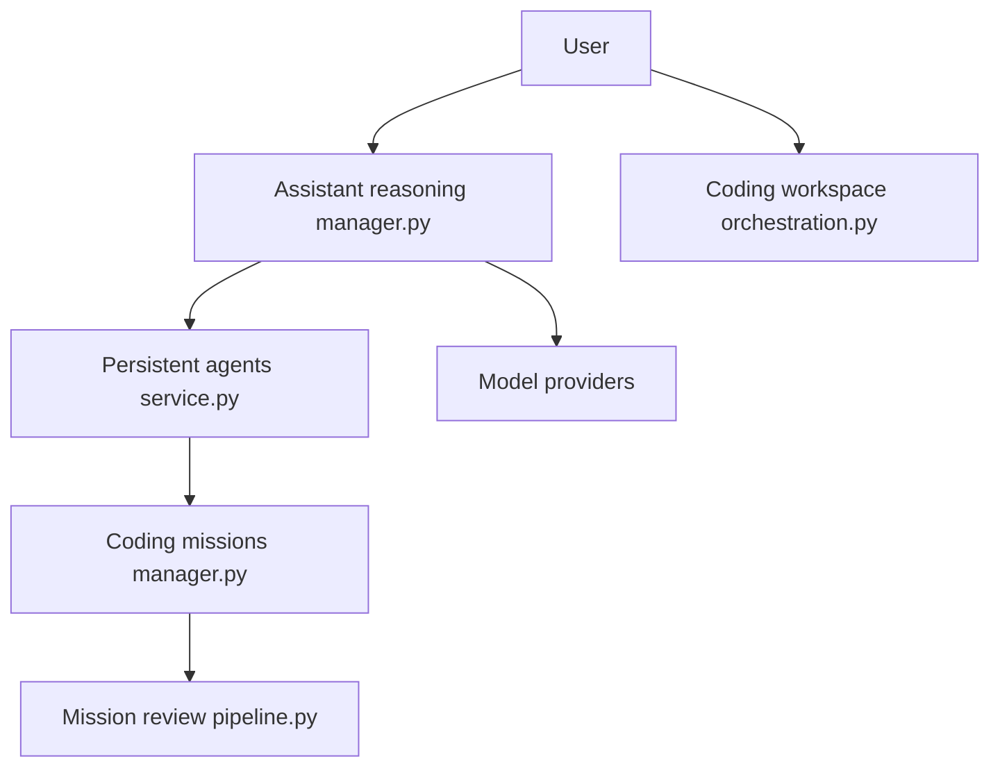

# Dodaios/Dodaios

> Application de bureau qui orchestre plusieurs agents de code depuis un seul chat, façon tech lead.

## Le problème
Avec dix terminaux, Claude Code ici et Codex là, on recopie le contexte, on réécrit les mêmes prompts et on perd la trace de qui a modifié quoi.

## Ce que ça fait vraiment
Un assistant local (avec mot d'éveil vocal) écrit les briefs, lance les agents de code dans un IDE agentique, surveille leur état et prévient quand l'un a fini ou attend une réponse. Il gère aussi missions de code avec revue, voix et dictée, usage de l'ordinateur, mémoire en wiki local, canaux de messagerie et marketplace. Le README dit que la plupart des plugins portent encore la mention Preview.

## Comment c'est branché



## Essayer
```bash
curl -fsSL https://raw.githubusercontent.com/Dodaios/Dodaios/main/install/install.sh | bash
dodaios
dodaios update
dodaios serve
```

## Coût et pièges
Dodaios est gratuit mais chaque agent tourne sur ton abonnement ou ta clé (Claude, OpenAI, Gemini, Ollama). Les installeurs ne sont pas signés. Un nouveau chat démarre en mode Bypass permissions, où rien ne demande confirmation.

## Ce que ce n'est pas
Pas un fournisseur de modèles. Pas un produit fini : appels téléphoniques en préversion, validation en direct seulement sous Windows 11.

## Alternatives
Aucune alternative nommée dans le README.

## Pour toi
À surveiller : concept utile pour piloter plusieurs agents, mais jeune, large et permissif par défaut ; teste dans un environnement jetable.

