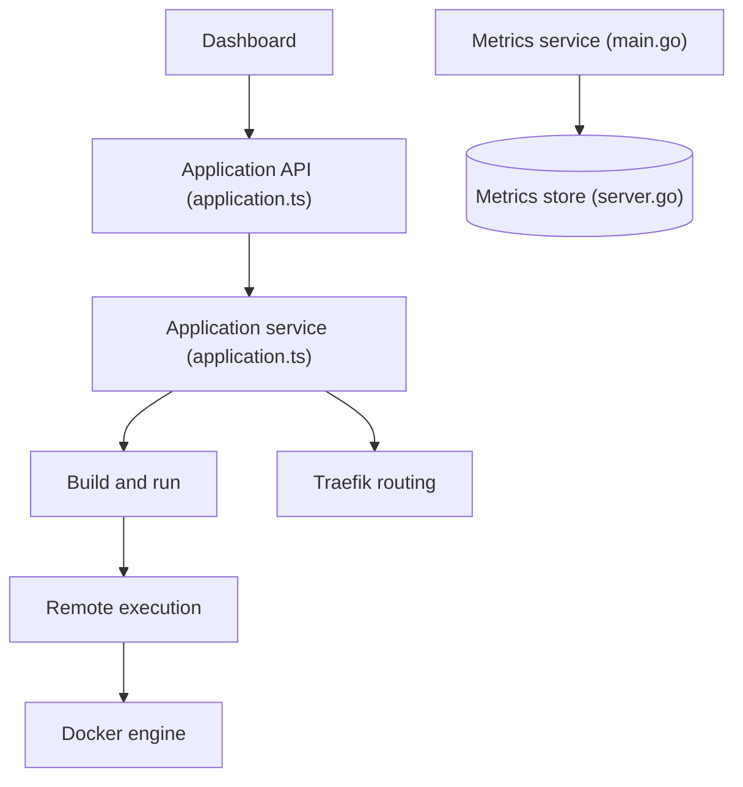

# Dokploy/dokploy

> Free, self-hostable PaaS platform for deploying applications and databases on your own server.

## The problem
Deploying applications and databases on a VPS means tinkering by hand with Docker, a reverse proxy, backups and monitoring.

## What it actually does
A dashboard that deploys apps (Node, PHP, Python, Go, Ruby), databases (MySQL, PostgreSQL, MongoDB, MariaDB, libsql, Redis) and Docker Compose stacks. Routing via Traefik, multi-server and multi-node Swarm, database backups to external storage, one-click templates, notifications, metrics sent to Grafana, Datadog, etc.

## How it is wired


## Trying it
```bash
curl -sSL https://dokploy.com/install.sh | bash
```
To be run on a VPS. Docs: docs.dokploy.com.

## Cost and gotchas
The software is free but you need a server at your expense. A Dokploy Cloud offer exists. The install script is executed directly from curl: review it before use.

## What it is not
Not an MLOps tool nor a pipeline orchestrator. License present but not identified by GitHub: read it before any commercial use.

## Alternatives
No alternative named in the README.

## For you
Handy for hosting demos or side services on a VPS, but the license needs checking and it is not an MLOps tool: keep an eye on it.
