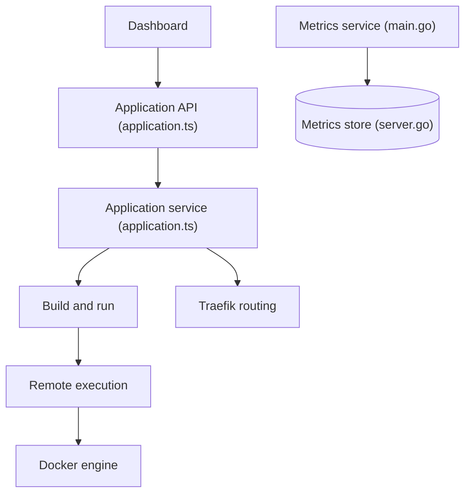

# Dokploy/dokploy

> Plateforme PaaS libre et auto-hébergeable pour déployer applications et bases de données sur son propre serveur.

## Le problème
Déployer des applications et des bases sur un VPS demande de bricoler Docker, reverse proxy, sauvegardes et supervision à la main.

## Ce que ça fait vraiment
Tableau de bord qui déploie des apps (Node, PHP, Python, Go, Ruby), des bases (MySQL, PostgreSQL, MongoDB, MariaDB, libsql, Redis) et des Docker Compose. Routage via Traefik, multi-serveurs et multi-nœuds Swarm, sauvegardes de bases vers un stockage externe, templates en un clic, notifications, métriques envoyées vers Grafana, Datadog, etc.

## Comment c'est branché


## Essayer
```bash
curl -sSL https://dokploy.com/install.sh | bash
```
À lancer sur un VPS. Doc : docs.dokploy.com.

## Coût et pièges
Le logiciel est gratuit mais il faut un serveur à ta charge. Une offre Dokploy Cloud existe. Le script d'installation est exécuté directement depuis curl : à relire avant usage.

## Ce que ce n'est pas
Pas un outil de MLOps ni d'orchestration de pipelines. Licence présente mais non identifiée par GitHub : à lire avant tout usage commercial.

## Alternatives
Aucune alternative nommée dans le README.

## Pour toi
Pratique pour héberger des démos ou services annexes sur un VPS, mais la licence est à vérifier et ce n'est pas un outil de MLOps : à surveiller.

