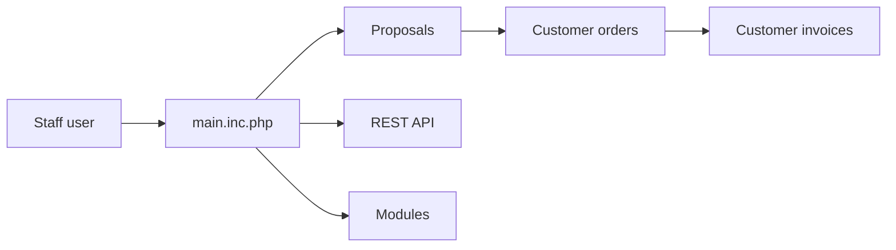

# Dolibarr/dolibarr

> Modular PHP ERP and CRM for small businesses, associations and freelancers: quotes, invoices, stock, HR.

## The problem
Managing customers, orders, invoices, stock and accounting in a single tool without a proprietary license.

## What it actually does
PHP web application with no heavy framework, with activatable modules: third parties, quotes/orders/invoices, stock, manufacturing (BOM), banking, accounting, projects, leave, document management (DMS), POS. REST and SOAP APIs, hooks and triggers (a workflow trigger creates the linked objects), AI support via API. Dolistore extension marketplace.

## How it is wired


## Trying it
```bash
git clone https://github.com/dolibarr/dolibarr -b x.y
```
Then open the `install/` page in the browser (README). Docker, Easypanel and packages exist.

## Cost and gotchas
Free when self-hosted; PHP and MariaDB/MySQL/PostgreSQL. Commercial SaaS offerings and paid extensions. 943 open issues.

## What it is not
No payroll module and no task dependencies in projects (listed by the README).

## Alternatives
No alternative named in the README.

## For you
Ignore: business-management ERP, unrelated to your data/AI practice.
