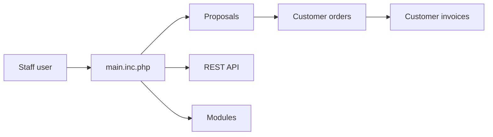

# Dolibarr/dolibarr

> ERP et CRM modulaire en PHP pour PME, associations et indépendants : devis, factures, stocks, RH.

## Le problème
Gérer clients, commandes, factures, stocks et compta dans un seul outil sans licence propriétaire.

## Ce que ça fait vraiment
Application web PHP sans framework lourd, avec modules activables : tiers, devis/commandes/factures, stocks, fabrication (BOM), banque, compta, projets, congés, GED, POS. API REST et SOAP, hooks et triggers (un trigger de workflow crée les objets liés), support IA via API. Boutique d'extensions Dolistore.

## Comment c'est branché


## Essayer
```bash
git clone https://github.com/dolibarr/dolibarr -b x.y
```
Puis ouvrir la page `install/` dans le navigateur (README). Docker, Easypanel et paquets existent.

## Coût et pièges
Gratuit auto-hébergé ; PHP et MariaDB/MySQL/PostgreSQL. Offres SaaS commerciales et extensions payantes. 943 issues ouvertes.

## Ce que ce n'est pas
Pas de module paie ni de dépendances de tâches dans les projets (listé par le README).

## Alternatives
Aucune alternative nommée dans le README.

## Pour toi
À ignorer : ERP de gestion d'entreprise, sans lien avec ta pratique data/IA.

