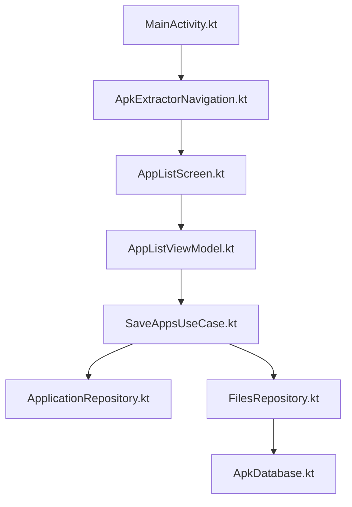

# Domilopment/apk-extractor

> Android application to back up, manage and restore the APKs of installed apps, without root.

## The problem
Android does not make it simple to keep an application's installation file in order to reinstall or share it.

## What it actually does
The app extracts APKs, including system applications, with filters and search. It backs up as a single APK or as a bundle (.apks, .xapk), can back up automatically at each update, and reinstalls from its backups. It offers an installer box for apks/xapk files.

## How it is wired

## Trying it
No command documented: the README describes how to use the interface and the steps to add a language.

## Cost and gotchas
Free, no root. Installing the binary is not detailed in the README. A backup of base.apk alone may crash on launch if split APKs are missing.

## What it is not
Not a backup of application data, only of installation files. Not a data science tool.

## Alternatives
No alternative named in the README.

## For you
Ignore for your line of work: a personal Android utility, useful only if you manage APKs yourself.
