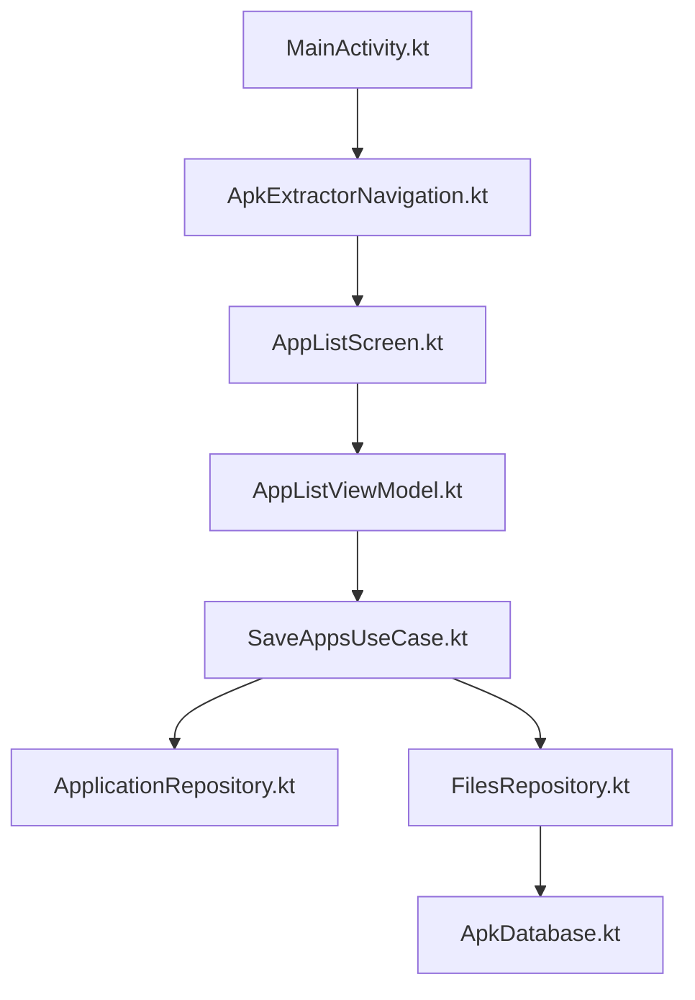

# Domilopment/apk-extractor

> Application Android pour sauvegarder, gérer et restaurer les APK des applications installées, sans root.

## Le problème
Android ne permet pas simplement de conserver le fichier d'installation d'une application pour la réinstaller ou la partager.

## Ce que ça fait vraiment
L'app extrait les APK, y compris les applications système, avec filtres et recherche. Elle sauvegarde en APK seul ou en bundle (.apks, .xapk), peut sauvegarder automatiquement à chaque mise à jour et réinstaller depuis ses sauvegardes. Elle propose une boîte d'installation pour les fichiers apks/xapk.

## Comment c'est branché

## Essayer
Aucune commande documentée : le README décrit l'usage de l'interface et la marche à suivre pour ajouter une langue.

## Coût et pièges
Gratuit, sans root. L'installation du binaire n'est pas détaillée dans le README. Une sauvegarde de base.apk seul peut planter au lancement si des APK fractionnés manquent.

## Ce que ce n'est pas
Ce n'est pas une sauvegarde des données des applications, seulement des fichiers d'installation. Ce n'est pas un outil de data science.

## Alternatives
Aucune alternative nommée dans le README.

## Pour toi
À ignorer pour ton métier : utilitaire Android personnel, utile seulement si tu gères toi-même des APK.

