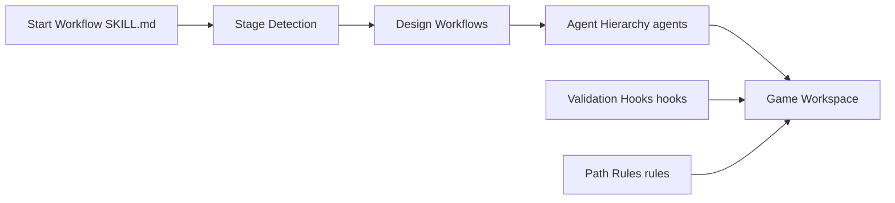

# Donchitos/Claude-Code-Game-Studios

> Claude Code project template with 49 agents and 74 commands to structure game development.

## The problem
A lone AI session enforces no design review, no QA pass, and no safeguards on hard-coded values.

## What it actually does
Clone it as a template: 49 agents in three tiers (directors, leads, specialists), 74 commands (`/start`, `/brainstorm`, `/dev-story`…), 15 validation hooks, 14 path-based rules, 62 document templates, Godot, Unity and Unreal kits. The `modes.rigor` level (`minimal` by default) sets how much process is applied. The README measures that the `standard` level produced 30 documents before the first code and was ranked last by two reviewers.

## How it is wired


## Trying it
```bash
git clone https://github.com/Donchitos/Claude-Code-Game-Studios.git my-game
cd my-game
claude
```
Then `/start` in the session.

## Cost and gotchas
Model calls are at your expense. Python 3 and Bash are required by the hooks; without Python, settings fall back to defaults. Launching `claude` outside the root disables hooks and rules.

## What it is not
Not a game engine nor an example game: no game is shipped. Not an autopilot: every decision requires validation.

## Alternatives
No alternative named in the README.

## For you
Ignore: game-development oriented; only the idea of hooks and path-based rules might inspire an agent workflow in MLOps.
