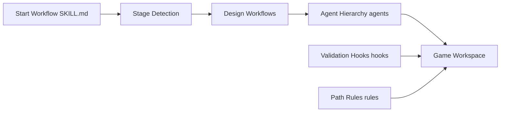

# Donchitos/Claude-Code-Game-Studios

> Modèle de projet Claude Code avec 49 agents et 74 commandes pour structurer le développement d'un jeu.

## Le problème
Une session d'IA seule n'impose ni revue de conception, ni passe QA, ni garde-fous sur les valeurs codées en dur.

## Ce que ça fait vraiment
À cloner comme gabarit : 49 agents en trois niveaux (directeurs, responsables, spécialistes), 74 commandes (`/start`, `/brainstorm`, `/dev-story`…), 15 hooks de validation, 14 règles par chemin, 62 modèles de documents, kits Godot, Unity et Unreal. Le niveau `modes.rigor` (`minimal` par défaut) règle la quantité de process. Le README mesure que le niveau `standard` a produit 30 documents avant le premier code et a été classé dernier par deux relecteurs.

## Comment c'est branché


## Essayer
```bash
git clone https://github.com/Donchitos/Claude-Code-Game-Studios.git my-game
cd my-game
claude
```
Puis `/start` dans la session.

## Coût et pièges
Les appels de modèle sont à ta charge. Python 3 et Bash requis par les hooks ; sans Python, les réglages retombent sur les valeurs par défaut. Lancer `claude` hors de la racine désactive hooks et règles.

## Ce que ce n'est pas
Pas un moteur de jeu ni un jeu exemple : aucun jeu n'est livré. Pas un pilote automatique : chaque décision demande validation.

## Alternatives
Aucune alternative nommée dans le README.

## Pour toi
À ignorer : orienté développement de jeux ; seule l'idée de hooks et de règles par chemin peut inspirer un flux d'agents en MLOps.

