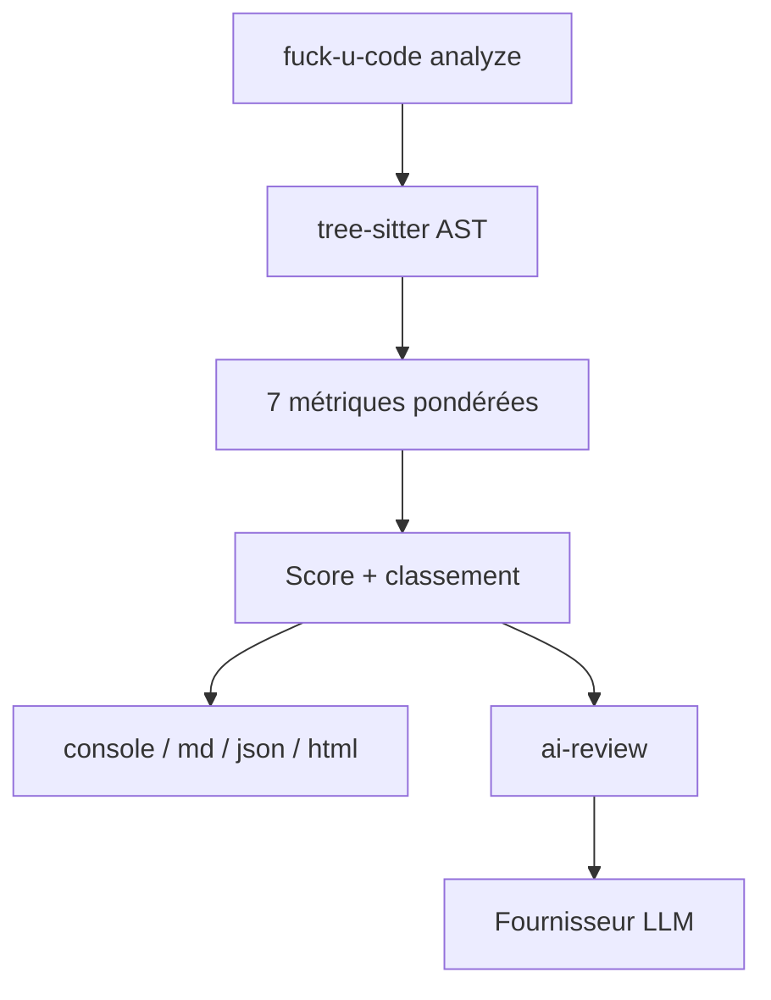

# Done-0/fuck-u-code

> CLI that scores code quality in 14 languages, with optional AI review, for developers.

## The problem
Hard to know which files in a project are the worst without manual review. Linters give no overall score.

## What it actually does
Offline analysis (tree-sitter) on seven criteria: complexity, size, comments, errors, naming, duplication, structure. Outputs an overall 0-100 score and a ranking of files. Console, Markdown, JSON or HTML output. The `ai-review` command sends the worst files to an LLM (OpenAI, Anthropic, DeepSeek, Gemini, Ollama). An MCP server is provided.

## How it is wired

No diagram provided: diagram inferred from the README.

## Trying it
```bash
npm install -g eff-u-code
fuck-u-code analyze ./src
fuck-u-code analyze . -f html -o report.html
fuck-u-code ai-review . -p ollama -m codellama
fuck-u-code mcp-install claude
```

## Cost and gotchas
Analysis is free and local. AI review requires an API key at your expense (or local Ollama). The npm package is called `eff-u-code`, the command `fuck-u-code`.

## What it is not
Not a rule-based linter: it is a heuristic score, with a deliberately mocking tone. The metric weightings are the author's, adjustable in config. AI review sends code to a third party.

## Alternatives
No alternative named in the README.

## For you
Worth watching: useful for roughing out a technical-debt audit or an MCP review server, but a humorous score and single-person maintenance limit its use in serious CI.
