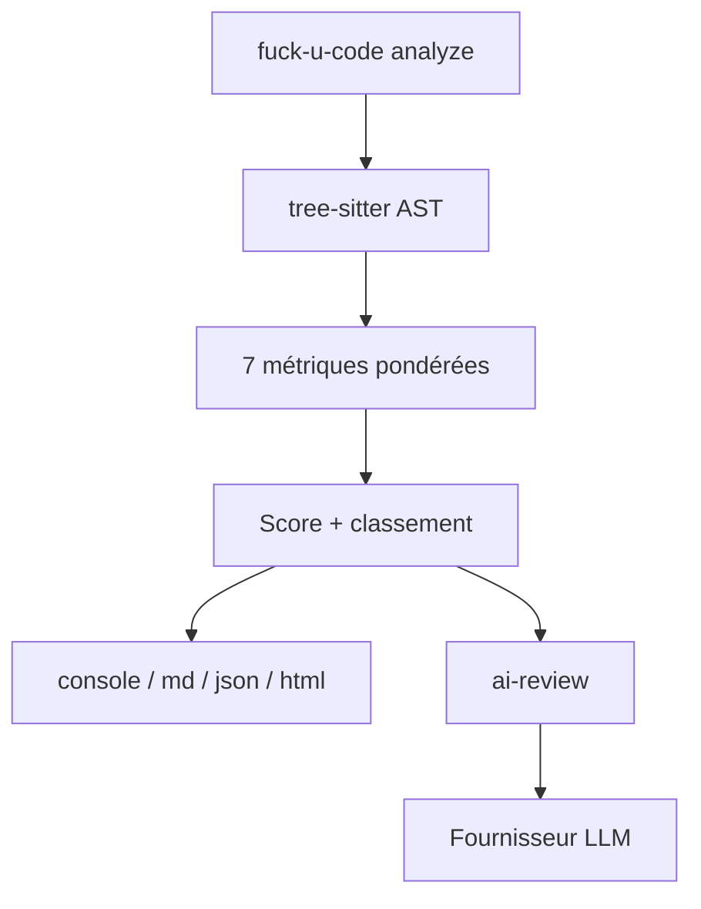

# Done-0/fuck-u-code

> CLI qui note la qualité de code en 14 langages, avec revue IA optionnelle, pour développeurs.

## Le problème
Difficile de savoir quels fichiers d'un projet sont les pires sans relecture manuelle. Les linters ne donnent pas de score global.

## Ce que ça fait vraiment
Analyse hors ligne (tree-sitter) selon sept critères : complexité, taille, commentaires, erreurs, nommage, duplication, structure. Sort un score global 0-100 et un classement des fichiers. Sorties console, Markdown, JSON ou HTML. La commande `ai-review` envoie les pires fichiers à un LLM (OpenAI, Anthropic, DeepSeek, Gemini, Ollama). Un serveur MCP est fourni.

## Comment c'est branché

Pas de diagramme fourni : schéma déduit du README.

## Essayer
```bash
npm install -g eff-u-code
fuck-u-code analyze ./src
fuck-u-code analyze . -f html -o report.html
fuck-u-code ai-review . -p ollama -m codellama
fuck-u-code mcp-install claude
```

## Coût et pièges
Analyse gratuite et locale. La revue IA exige une clé d'API à ta charge (ou Ollama local). Le paquet npm s'appelle `eff-u-code`, la commande `fuck-u-code`.

## Ce que ce n'est pas
Pas un linter de règles : c'est une note heuristique, au ton volontairement moqueur. Les pondérations des métriques sont celles de l'auteur, modifiables en config. La revue IA envoie du code à un tiers.

## Alternatives
Aucune alternative nommée dans le README.

## Pour toi
À surveiller : utile pour dégrossir un audit de dette technique ou un serveur MCP de revue, mais un score humoristique et une maintenance par une seule personne limitent l'usage en CI sérieuse.

